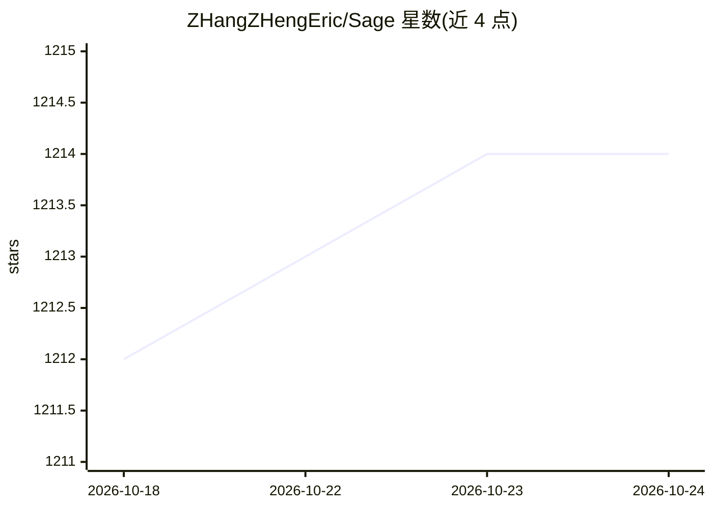

# ZHangZHengEric/Sage

⭐ 1,214 · Python · MIT · 推送 2026-10-24 · [GitHub](https://github.com/ZHangZHengEric/Sage) · [官网](https://zhangzhengeric.github.io/Sage/) · 组织维护 · 中文 README

**构建自定义自进化 AI Agent 的开源平台（运行时+桌面+服务端）**

Sage 是构建自定义、可自我进化 AI Agent 的平台：用 sage.yaml 定义 Agent 包（指令、技能、工具、运行时配置），在独立 Session 中通过 RSI（递归自我改进）多轮循环对包做评估、调优与语义审查，保留每次迭代版本供用户选择采纳。提供 Flutter 桌面端（含原生流式交互 UI）、多用户服务端与可嵌入 Python 应用的 SAgents v2 运行时，插件化组合模型/记忆/存储/工具/调度 Provider，支持 MCP 工具与多 Agent 编排。限制：本地进程执行非容器隔离，Server v2 仅支持单 worker，macOS 包未公证、Windows 未签名。

## 筛选速览

| 维度 | 判定 | 备注 |
|---|---|---|
| AI 角色 | `ai-ecosystem` | LLM/agent 周边工具 |
| 许可风险 | `permissive` | MIT |
| 部署形态 | `library` | 以包/库形式分发 |
| 模型依赖 | — | README 未给出锁定关系 |
| 硬件要求 | — | 无带数字的原话,不猜 |
| 安装摩擦 | `low` | 无编译、无系统依赖或容器化 |
| 成熟度 | — | 结构信号不足 |

## 能力要点

- RSI 多轮递归自我改进：独立审计/评估/审查 Session，保留全部迭代版本并显式确认采纳
- 插件化架构：模型、记忆、存储、工具、调度 Provider 显式契约组合
- 一运行时多宿主：Desktop、Server 与 Python 嵌入三种形态
- 桌面端原生流式 UI：31 种组件类型、PPTX 导出，Python 与后端已捆绑

## 适用场景

- 定义自己的 Agent 包并通过 RSI 循环测试和优化
- 通过桌面端配置 Agent、查看 RSI 历史并选择版本
- 将 Agent 运行时嵌入自己的 Python 应用
- 部署多用户服务端并用 Agent Studio 管理包

## 场景标签

`多智能体` `Agent 框架` · 领域:Agent 开发

## 证据(README 行号)

> L17: > 🌟 **An open-source platform for building custom, self-evolving AI agents. Define an Agent package, evaluate it, a
> L27: - 📦 **Custom Agent packages** — Define your agent's instructions, Skills, tools, and runtime configuration in `sage
> L34: - 🏗️ **One runtime, multiple hosts** — Use SAgents v2 through Desktop and Server, or embed it in your own Python ap

## 星数曲线

2026-10-18 1,212 → 2026-10-24 1,214（+2）

---
*卡片 v1 · prompt 1.4 · 生成 2026-10-21 · 置信度 high · 依据 README sha `f07e2964566f` · [字段定义](../../DATASET.md)*
