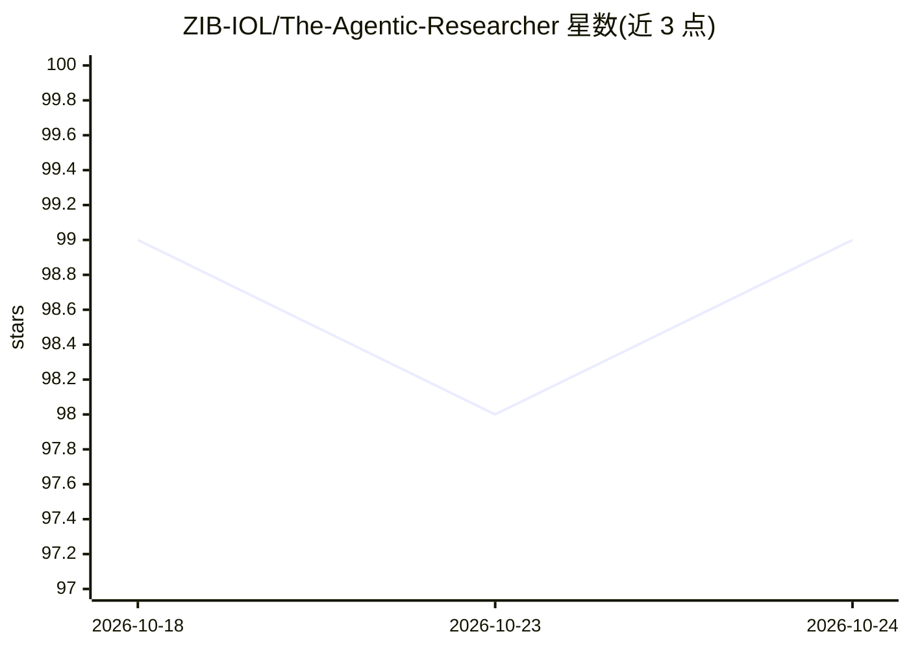

# ZIB-IOL/The-Agentic-Researcher

⭐ 99 · Shell · MIT · 推送 2026-06-12 · [GitHub](https://github.com/ZIB-IOL/The-Agentic-Researcher) · 组织维护

**在沙箱容器中运行 AI 编码 agent 的科研框架**

由 ZIB-IOL（柏林Zuse研究所与柏林工业大学）发布的框架：将 AI 编码 agent（Claude Code、OpenCode、Gemini CLI、Codex CLI、pi）启动于沙箱化容器中，提供文件系统隔离、命名空间隔离、路径穿越防护与 GPU 直通；容器运行时支持 Docker/Podman/Apptainer，可经 Slurm 多节点分发远程实验。框架附带 INSTRUCTIONS.md 研究规范模板与 /setup_research_plan 交互流程，自动生成研究计划与 report.tex/TODO.md 跟踪文件。面向数学与机器学习研究者，需自备 CLI 工具的 API key 或 OAuth 登录。

## 筛选速览

| 维度 | 判定 | 备注 |
|---|---|---|
| AI 角色 | `ai-ecosystem` | LLM/agent 周边工具 |
| 许可风险 | `permissive` | MIT |
| 部署形态 | `self-host` | docker 或自建部署 |
| 模型依赖 | locked-api |  |
| 硬件要求 | — | 无带数字的原话,不猜 |
| 安装摩擦 | `low` | 无编译、无系统依赖或容器化 |
| 成熟度 | — | 结构信号不足 |

## 能力要点

- 支持 5 种 AI 编码 CLI（Claude Code/OpenCode/Gemini CLI/Codex CLI/pi）
- 沙箱隔离：文件系统限定 /workspace、用户/挂载命名空间、路径穿越防护
- Slurm + Apptainer 多节点 GPU 实验分发（--multi-node）
- 内置研究规范模板与 /setup_research_plan 项目规划流程

## 适用场景

- 在隔离沙箱中让 AI agent 安全地跑深度学习实验与训练任务
- 为数学/机器学习研究项目生成结构化研究计划并跟踪进度
- 在 HPC 集群上分发多节点 GPU 实验给 agent 执行

## 场景标签

`编码 Agent` `科研工具` · 领域:编码与开发

## 证据(README 行号)

> L21: The Agentic Researcher launches AI coding agents inside **sandboxed containers** with filesystem isolation, GPU sup
> L23: Supports Claude Code, OpenCode, Gemini CLI, Codex CLI, and pi.

## 星数曲线

2026-10-18 99 → 2026-10-24 99（+0）

---
*卡片 v1 · prompt 1.4 · 生成 2026-10-23 · 置信度 mid · 依据 README sha `0ab2186e342c` · [字段定义](../../DATASET.md)*
