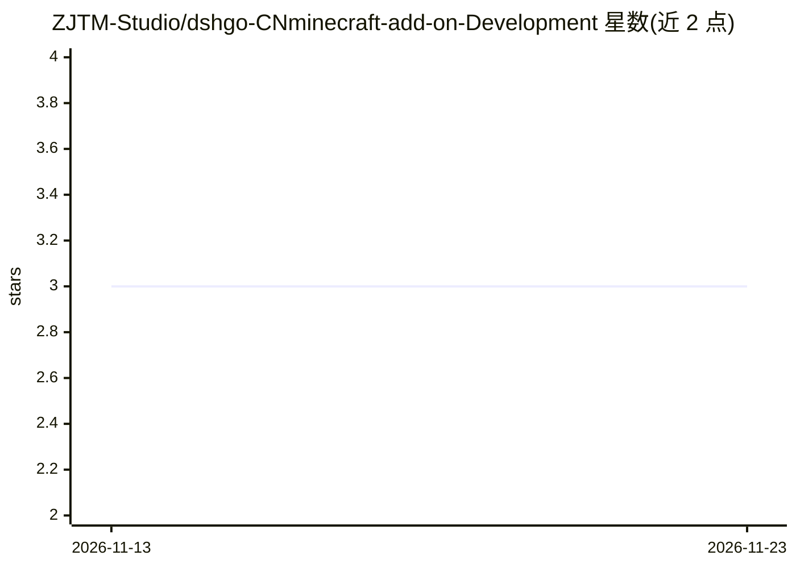

# ZJTM-Studio/dshgo-CNminecraft-add-on-Development

⭐ 3 · JavaScript · MIT · 推送 2026-11-11 · [GitHub](https://github.com/ZJTM-Studio/dshgo-CNminecraft-add-on-Development) · 组织维护 · 中文 README

**网易 MC 模组开发的 DSH Agent 预设包：产出可导入 MCStudio 的模组包**

一个 DSH Agent 预设包（bundle），安装后在 DSH 预设选择器中出现专用的网易 MC 模组开发 Agent。选中后加载人格与 22 个工具条目（文件、bash、网络、规划、任务等），回答前先 grep 本地 845 页网易官方文档库，输出完整文件树与每个文件的完整内容，只写网易 ModSDK/Apollo/Python 脚本，禁用国际版 API。不装知识库时退化为普通助手。通过 git clone + dsh plugin 命令安装。

## 筛选速览

| 维度 | 判定 | 备注 |
|---|---|---|
| AI 角色 | `ai-ecosystem` | LLM/agent 周边工具 |
| 许可风险 | `permissive` | MIT |
| 部署形态 | `None` |  |
| 模型依赖 | — | README 未给出锁定关系 |
| 硬件要求 | — | 无带数字的原话,不猜 |
| 安装摩擦 | `low` | 无编译、无系统依赖或容器化 |
| 成熟度 | — | 结构信号不足 |

## 能力要点

- 先检索本地 845 页网易官方文档再回答，查不到明说「文档里没有」
- 产出行为包+资源包成对的完整模组包，uuid 唯一、路径大小写严格对齐
- 加载 22 个工具条目（文件/执行/网络/规划/任务等分类）
- 交付前强制自检：能否导入、uuid 是否唯一、路径大小写是否正确

## 适用场景

- 让 AI 直接生成可导入 MCStudio 的网易 MC 完整模组包
- 开发网易 ModSDK / Apollo Python 脚本时按官方文档约束回答
- 避免混淆国际版 @minecraft/server API 与网易版目录布局

## 场景标签

`编码 Agent` · 领域:编码与开发

## 证据(README 行号)

> L5: **DSH Agent 预设 · 网易《我的世界》中国版模组开发专用**
> L23: 一个 **DSH Agent 预设包**（bundle），安装后在预设选择器里多出一个专用 Agent。选中它开的会话会加载一套为网易 MC 模组开发定制的能力：
> L84: - **文档优先**：回答前先检索 845 页官方文档，查不到明说「文档里没有」，不编造 API

## 星数曲线

2026-11-13 3 → 2026-11-23 3（+0）

---
*卡片 v1 · prompt 1.4 · 生成 2026-11-22 · 置信度 mid · 依据 README sha `ad93e508bccd` · [字段定义](../../DATASET.md)*
