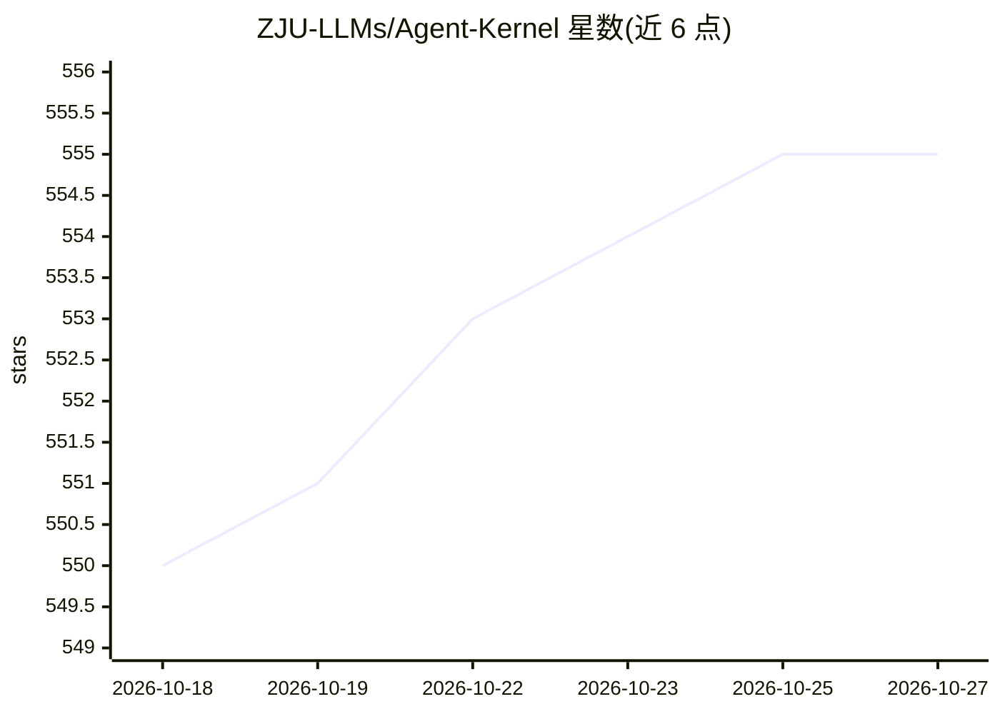

# ZJU-LLMs/Agent-Kernel

⭐ 555 · Python · Apache-2.0 · 推送 2026-06-03 · [GitHub](https://github.com/ZJU-LLMs/Agent-Kernel) · [官网](https://www.agent-kernel.tech) · 组织维护 · 中文 README

**面向大规模 LLM 社会模拟的微内核多智能体系统框架**

Agent-Kernel 是支持 LLM 驱动的大规模社会模拟的多智能体系统开发框架，采用微内核架构：Agent、Environment、Action、Controller、System 五个核心模块加插件体系。支持运行时动态增删智能体、无限扩展智能体数量、模拟过程中实时干预，以及系统级的行为与大模型输出校验机制。以 pip 包形式提供 standalone 与 distributed（依赖 Ray）两种安装，可选 web/storages 扩展，并附带 Society-Panel 可视化控制面板，用于配置、部署与监控模拟。已应用于 Universe 25 实验、校园生活、OpenHospital 医院模拟等场景，附 arXiv 论文。

## 筛选速览

| 维度 | 判定 | 备注 |
|---|---|---|
| AI 角色 | `ai-ecosystem` | LLM/agent 周边工具 |
| 许可风险 | `permissive` | Apache-2.0 |
| 部署形态 | `library` | 以包/库形式分发 |
| 模型依赖 | — | README 未给出锁定关系 |
| 硬件要求 | — | 无带数字的原话,不猜 |
| 安装摩擦 | `low` | 无编译、无系统依赖或容器化 |
| 成熟度 | — | 结构信号不足 |

## 能力要点

- 微内核架构：Agent/Environment/Action/Controller/System 核心模块 + 插件体系
- 运行时动态增删 LLM 智能体，智能体数量无上限扩展
- Controller 支持模拟过程中的实时参数与事件干预
- 系统级行为校验机制，验证智能体动作与大模型输出

## 适用场景

- 构建大规模 LLM 驱动的社会学/群体行为模拟实验
- 在模拟运行中实时调整参数与事件以验证社会学假设
- 复用插件代码跨场景快速搭建仿真（校园、医院等）
- 通过 Society-Panel 可视化部署与监控模拟

## 场景标签

`Agent 框架` `多智能体` · 领域:Agent 开发

## 证据(README 行号)

> L41: **Agent-Kernel** is a user-friendly multi-agent system development framework, which is designed to powerfully enabl
> L113: The Agent-Kernel framework adopts a modular microkernel architecture, with a core system—composed of the **Agent**
> L127: - `Python ≥ 3.11`

## 星数曲线

2026-10-18 550 → 2026-10-27 555（+5）

---
*卡片 v1 · prompt 1.4 · 生成 2026-10-21 · 置信度 high · 依据 README sha `8a2c2ec3dae0` · [字段定义](../../DATASET.md)*
