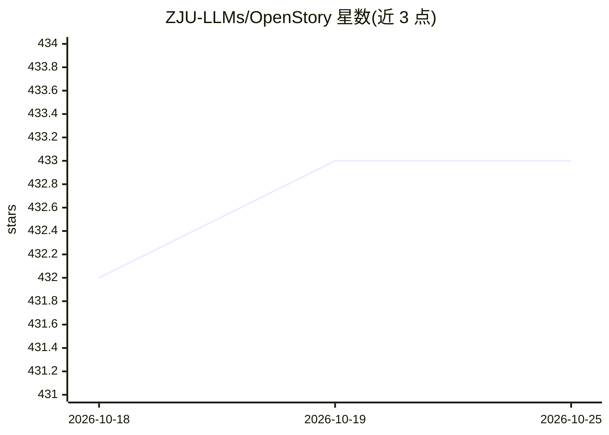

# ZJU-LLMs/OpenStory

⭐ 433 · Python · Apache-2.0 · 推送 2026-08-19 · [GitHub](https://github.com/ZJU-LLMs/OpenStory) · 组织维护 · 中文 README

**LLM 多智能体框架：模拟可交互、可演化的故事世界**

基于 LLM 与 Agent-Kernel 的多智能体推演与模拟框架，含三个官方故事示例：《红楼梦》大观园一比一地图推演、《西部世界》自由/剧情模式、以及 WorldKernel 一句话生成角色、地点、路径与规则并接入模拟。底层支持推演中动态增删智能体，提供插件化生命周期（感知/计划/执行/反思）与 YAML 配置，可视化前端可查看人物轨迹与档案。运行需本地 Redis（6379 端口）、Python 3.10+、OpenAI-compatible 模型配置，另提供一键即玩的 Launcher 客户端与 DeepSeek Harness 插件。

## 筛选速览

| 维度 | 判定 | 备注 |
|---|---|---|
| AI 角色 | `ai-ecosystem` | LLM/agent 周边工具 |
| 许可风险 | `permissive` | Apache-2.0 |
| 部署形态 | `library` | 以包/库形式分发 |
| 模型依赖 | locked-api |  |
| 硬件要求 | — | 无带数字的原话,不猜 |
| 安装摩擦 | `low` | 无编译、无系统依赖或容器化 |
| 成熟度 | — | 结构信号不足 |

## 能力要点

- 一句话生成可交互世界（WorldKernel）
- Agent-Kernel 架构支持推演中动态增删智能体
- 感知/计划/执行/反思插件化机制与 YAML 配置
- 一比一复刻红楼梦大观园的可视化前端与剧情回溯

## 适用场景

- 在红楼梦/西部世界等沙盘中观察或参与多智能体剧情推演
- 用一句自然语言生成自定义故事世界并互动
- 基于插件机制构建自己的多智能体社会模拟实验

## 场景标签

`多智能体` · 领域:Agent 开发

## 证据(README 行号)

> L28: OpenStory 是一个基于大语言模型（LLM）和 Agent-Kernel 开发的多智能体推演与模拟框架。
> L37: - **丰富的插件化机制与高可配性**：涵盖智能体感知、计划、执行、反思等完整生命周期插件，并支持通过 YAML 文件灵活管理系统、环境、动作与智能体配置。

## 星数曲线

2026-10-18 432 → 2026-10-25 433（+1）

---
*卡片 v1 · prompt 1.4 · 生成 2026-10-22 · 置信度 high · 依据 README sha `6ac50ca7f5eb` · [字段定义](../../DATASET.md)*
