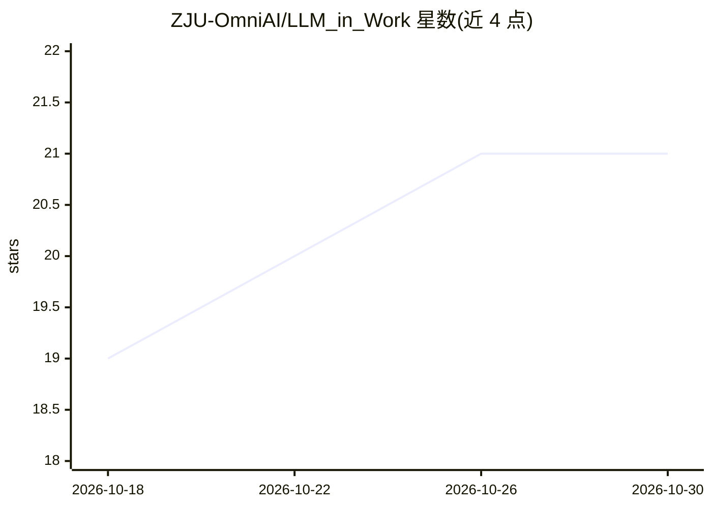

# ZJU-OmniAI/LLM_in_Work

⭐ 21 · JavaScript · MIT · 推送 2026-10-23 · [GitHub](https://github.com/ZJU-OmniAI/LLM_in_Work) · 组织维护 · 中文 README

**把本地 Claude Code/Codex CLI 接入 Word、Overleaf、PPT、Excel 与 Chrome PDF 的五个助手**

由浙大 OmniAI 团队（ZJU-OmniAI）开发的办公文档 AI 编辑桥接套件：通过 Office 加载项、Chrome 扩展与 Native Messaging 连接到本机已登录的 Claude Code 或 Codex CLI，在 Word、Overlef、Chrome 内 PDF、PowerPoint、Excel 中实现选中即改——编辑以 diff 预览呈现、确认后才写入，并提供文档问答。全程本地桥接、无自有云服务，无需 API key，走已有订阅。需 Node.js 22.13+/24+ 与已登录的 CLI，从源码 clone 后按平台运行 install 脚本安装。

## 筛选速览

| 维度 | 判定 | 备注 |
|---|---|---|
| AI 角色 | `ai-ecosystem` | LLM/agent 周边工具 |
| 许可风险 | `permissive` | MIT |
| 部署形态 | `desktop` | 安装包/桌面程序 |
| 模型依赖 | — | README 未给出锁定关系 |
| 硬件要求 | — | 无带数字的原话,不猜 |
| 安装摩擦 | `low` | 无编译、无系统依赖或容器化 |
| 成熟度 | — | 结构信号不足 |

## 能力要点

- 五个助手覆盖 Word/Overleaf/Chrome PDF/PowerPoint/Excel 的选中式编辑与问答
- 编辑以 diff 预览呈现，确认后才应用；Word 生成原生修订，PPT/Excel 有一键撤销
- 驱动本机已登录的 Claude Code 或 Codex CLI，无需 API key 与新账号
- PDF 阅读为只读问答，支持文字与图表裁剪提问，不改动原文档

## 适用场景

- 写论文时在 Word/Overleaf 里选中段落让 AI 局部修改并核对 diff
- 在 Chrome 里读 arXiv 论文，选中段落或裁剪图表提问
- 在 PowerPoint 内做整页排版重构与讲稿备注问答
- 在 Excel 里按行填充整列分类并保留原格式

## 场景标签

`AI 写作` `文档问答` · 领域:内容生成

## 证据(README 行号)

> L22: **LLM_in_Work connects the agents already installed and signed in on your computer to your everyday software.** Sel
> L106: All five bridges run locally and add no cloud service of their own. The model itself runs wherever your CLI sends 
> L110: **You need:** Node.js 22.13+ (22.x) or 24+, and at least one CLI installed and signed in: Claude Code (`claude aut

## 星数曲线

2026-10-18 19 → 2026-10-30 21（+2）

---
*卡片 v1 · prompt 1.4 · 生成 2026-10-28 · 置信度 high · 依据 README sha `7270350cec02` · [字段定义](../../DATASET.md)*
