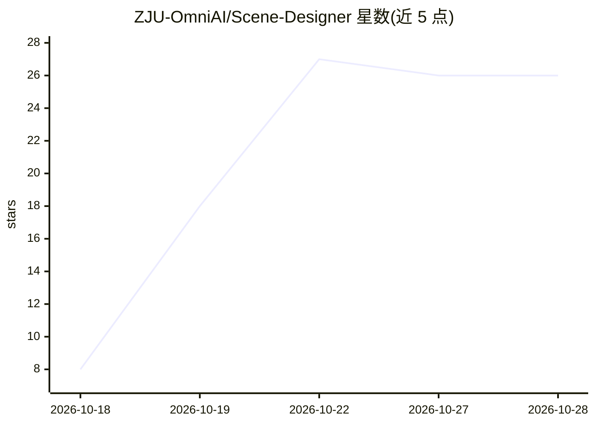

# ZJU-OmniAI/Scene-Designer

⭐ 27 · Python · 推送 2026-10-19 · [GitHub](https://github.com/ZJU-OmniAI/Scene-Designer) · [官网](https://zju-omniai.github.io/Scene-Designer/) · 组织维护 · 中文 README

**学习设计智能的 Agent 式 3D 场景生成框架与模型**

浙江大学 OmniAI 组的 3D 场景生成研究项目：通过监督微调（Scene-OTA-35K 轨迹经验、Scene-OTC-15K 批评经验）与 Scene-GRPO 强化学习（分支排序奖励与改进奖励）训练出 Scene-Builder 模型（基于 Qwen3-VL-8B-Instruct），可设计并评估物理有效、功能正确、布局连贯的室内场景。已发布 SFT 权重与 Scene-OTC-Bench 评测集，提供数据构建、训练与场景生成流程；依赖外部 SceneSmith 工具链（需单独下载），要求 Linux 与 Python 3.11。

## 筛选速览

| 维度 | 判定 | 备注 |
|---|---|---|
| AI 角色 | `ai-native` | 本体是模型或模型工具 |
| 许可风险 | `none` | — |
| 部署形态 | `None` |  |
| 模型依赖 | — | README 未给出锁定关系 |
| 硬件要求 | — | 无带数字的原话,不猜 |
| 安装摩擦 | `low` | 无编译、无系统依赖或容器化 |
| 成熟度 | — | 结构信号不足 |

## 能力要点

- 基于 Qwen3-VL-8B-Instruct 的 SFT 权重 Scene-Builder
- Scene-OTA-35K 与 Scene-OTC-15K 两类设计/批评经验数据构建流水线
- Scene-GRPO：分支排序奖励+改进奖励的强化学习阶段
- 发布 Scene-OTC-Bench（94 个两场景对比+55 个四场景排序题）

## 适用场景

- 用文本提示生成带家具、墙体、天花板的室内 3D 场景
- 复现轨迹压缩与 CoT 标注的 SFT 数据构建流程
- 在 Scene-OTC-Bench 上评测场景设计模型

## 场景标签

`微调` `强化学习` · 领域:训练与推理

## 证据(README 行号)

> L28: **Scene-Designer** learns **design intelligence**: the ability to both **design a scene** and **critique its qualit
> L58: |**Scene-Builder-Qwen3-VL-8B-Instruct**|Full SFT checkpoint, initialized from Qwen3-VL-8B-Instruct|🤗 Model|
> L121: python -m src.rollout_client --server-url http://127.0.0.1:18000 \

## 星数曲线

2026-10-18 8 → 2026-10-28 26（+18）

---
*卡片 v1 · prompt 1.4 · 生成 2026-10-26 · 置信度 high · 依据 README sha `666fe1bb7029` · [字段定义](../../DATASET.md)*
