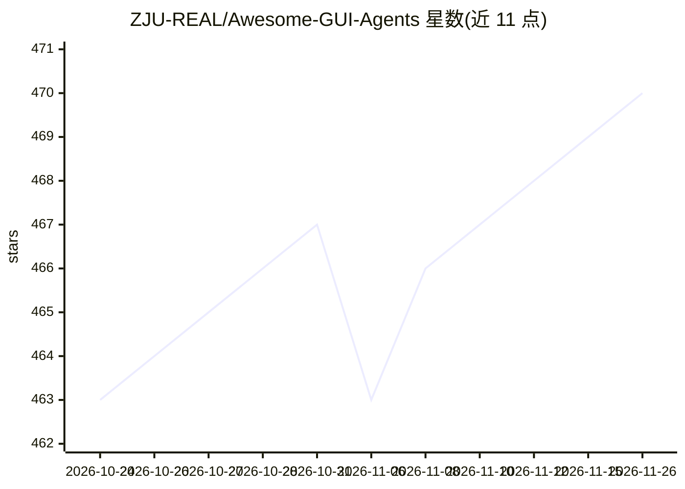

# ZJU-REAL/Awesome-GUI-Agents

⭐ 470 · 推送 2026-11-18 · [GitHub](https://github.com/ZJU-REAL/Awesome-GUI-Agents) · [官网](https://arxiv.org/abs/2504.13865) · 组织维护 · 中文 README

**GUI Agent 研究资源的论文与基准策展清单**

由浙江大学团队维护的 GUI Agents 领域资源清单：按技术报告、Computer-use Agents、强化学习、记忆机制、World Model、Grounding 基准、视频 GUI 等主题组织论文列表，并附每周更新的论文汇总（如 AAAI/ICLR 2026 收录论文分析）与 GUI Agent 四模块（感知/探索/规划/交互）框架。仓库同时发布团队自身的 GUI Agent 研究论文（GUI-G²、UI-S1 等）与开源模型。内容为论文与数据集索引，不含可安装运行的软件本体。

## 筛选速览

| 维度 | 判定 | 备注 |
|---|---|---|
| AI 角色 | `ai-knowledge` | 知识聚合/清单类 |
| 许可风险 | `none` | — |
| 部署形态 | `None` |  |
| 模型依赖 | — | README 未给出锁定关系 |
| 硬件要求 | — | 无带数字的原话,不猜 |
| 安装摩擦 | `medium` | 含编译或系统依赖之一 |
| 成熟度 | — | 结构信号不足 |

## 能力要点

- 按技术报告、RL、记忆、World Model、Grounding 基准等主题组织的论文列表
- 每周论文列表汇总（含 AAAI/ICLR 2026 GUI Agent 论文分析）
- GUI Agent 四模块划分：perception、exploration、planning、interaction
- 附带团队自研论文与开源模型（ClawGUI、GUI-G2 等）的发布记录

## 适用场景

- 调研 GUI Agent 领域的最新论文与基准
- 为 GUI Agent 研究查找数据集与评测基准
- 跟踪计算机使用/移动端 GUI 自动化方向的进展

## 场景标签

`精选清单` · 领域:学习与行业

## 证据(README 行号)

> L2: A curated list for **GUI Agents**
> L95: ## Paper List
> L56: * March 24, 2025: We updated the repository and released our comprehensive survey on GUI Agents.

## 星数曲线

2026-10-24 463 → 2026-11-26 470（+7）

---
*卡片 v1 · prompt 1.4 · 生成 2026-11-25 · 置信度 high · 依据 README sha `9127d0543b6d` · [字段定义](../../DATASET.md)*
