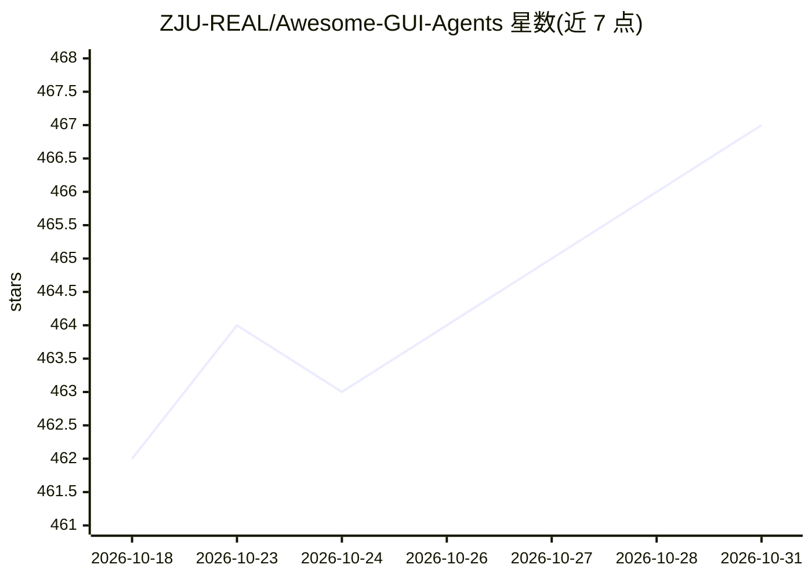

# ZJU-REAL/Awesome-GUI-Agents

⭐ 467 · 推送 2026-07-28 · [GitHub](https://github.com/ZJU-REAL/Awesome-GUI-Agents) · [官网](https://arxiv.org/abs/2504.13865) · 组织维护 · 中文 README

**GUI Agent 研究论文与资源策展清单（浙大团队维护）**

由浙江大学团队维护的 GUI Agents 领域策展仓库：按感知、探索、规划、交互四模块划分领域，收录技术报告、论文、数据集与基准测试，涵盖在线强化学习、记忆机制、世界模型、GUI Grounding、视频辅助学习等专题；每周更新论文列表，并汇总 AAAI/ICLR 2026 接收论文。同时发布团队自身成果（UI-S1、GUI-G² 系列模型、ClawGUI 框架）。以 Markdown 清单形式提供，无安装步骤，通过 PR 收录新论文。

## 筛选速览

| 维度 | 判定 | 备注 |
|---|---|---|
| AI 角色 | `ai-knowledge` | 知识聚合/清单类 |
| 许可风险 | `none` | — |
| 部署形态 | `None` |  |
| 模型依赖 | — | README 未给出锁定关系 |
| 硬件要求 | — | 无带数字的原话,不猜 |
| 安装摩擦 | `low` | 无编译、无系统依赖或容器化 |
| 成熟度 | — | 结构信号不足 |

## 能力要点

- 按感知/探索/规划/交互四模块组织 GUI Agent 研究脉络
- 每周论文列表与 AAAI/ICLR 2026 接收论文汇总
- 覆盖在线 RL、记忆、世界模型、Grounding、隐私等十余个专题
- 附带团队自研论文与开源模型（GUI-G² 3B/7B）入口

## 适用场景

- 跟踪 GUI Agent 领域最新论文与研究动态
- 按专题查找数据集与评测基准
- 了解 GUI Agent 的技术分类体系以规划研究方向

## 场景标签

`精选清单` · 领域:学习与行业

## 证据(README 行号)

> L2: A curated list for **GUI Agents**
> L89: ## Four Module of GUI Agents
> L97: We have dedicated a separate chapter to datasets and benchmarks for GUI Agents, with all content presented in chron

## 星数曲线

2026-10-18 462 → 2026-10-31 467（+5）

---
*卡片 v1 · prompt 1.4 · 生成 2026-10-22 · 置信度 high · 依据 README sha `1b64d805e832` · [字段定义](../../DATASET.md)*
