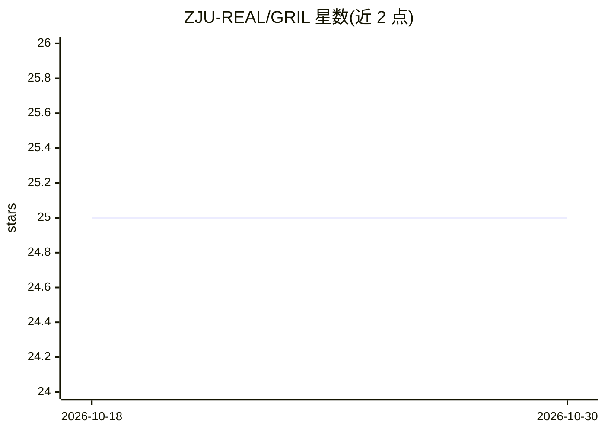

# ZJU-REAL/GRIL

⭐ 25 · Python · 推送 2026-04-24 · [GitHub](https://github.com/ZJU-REAL/GRIL) · 组织维护 · 中文 README

**训练 LLM 识别信息缺口的多轮强化学习框架**

ACL 2026 findings 论文的官方实现：提出 GRIL（Grounded Reasoning via Interactive Reinforcement Learning），一个多轮 RL 训练框架，训练语言模型在前提不足时暂停并请求澄清，而非编造缺失前提继续推理。机制为两阶段奖励：澄清阶段使用时间衰减奖励鼓励早发现缺失信息，接地推理阶段在前提补齐后按答案正确性给奖励，并对完整问题上的多余澄清施加惩罚。基于 veRL 实现，提供 Conda 环境配置、训练脚本与评测脚本，面向复现与研究的开发者。

## 筛选速览

| 维度 | 判定 | 备注 |
|---|---|---|
| AI 角色 | `ai-ecosystem` | LLM/agent 周边工具 |
| 许可风险 | `none` | — |
| 部署形态 | `library` | 以包/库形式分发 |
| 模型依赖 | — | README 未给出锁定关系 |
| 硬件要求 | — | 无带数字的原话,不猜 |
| 安装摩擦 | `low` | 无编译、无系统依赖或容器化 |
| 成熟度 | — | 结构信号不足 |

## 能力要点

- 两阶段奖励：时间衰减的早检测奖励 + 前提补齐后的正确性奖励
- 对完整问题施加惩罚以抑制多余澄清请求
- 在 GSM8K-Insufficient / MetaMATH-Insufficient 基准上训练 Qwen2.5/Qwen3 系列模型并评测
- 提供 Conda 环境文件、train.sh 训练脚本与 eval.py 评测脚本

## 适用场景

- 复现论文中接地推理训练流程
- 研究 LLM 在信息不足场景下的暂停/澄清行为
- 在 GSM8K-Insufficient 类数据上训练与评测小规模模型

## 场景标签

`强化学习` · 领域:训练与推理

## 证据(README 行号)

> L14: We propose **GRIL** (**G**rounded **R**easoning via **I**nteractive **R**einforcement **L**earning), a multi-turn R
> L141: This project builds on veRL. We thank the authors of that project.

## 星数曲线

2026-10-18 25 → 2026-10-30 25（+0）

---
*卡片 v1 · prompt 1.4 · 生成 2026-10-27 · 置信度 mid · 依据 README sha `a51c5750ee8c` · [字段定义](../../DATASET.md)*
