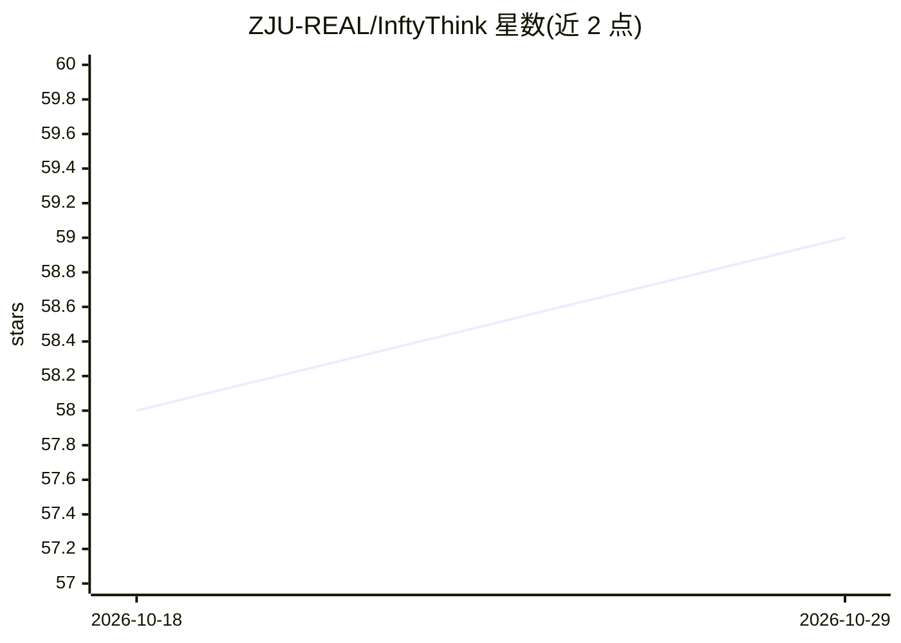

# ZJU-REAL/InftyThink

⭐ 59 · Python · MIT · 推送 2026-05-05 · [GitHub](https://github.com/ZJU-REAL/InftyThink) · [官网](https://zju-real.github.io/InftyThink/) · 组织维护

**论文项目：将长上下文推理切分为带摘要的迭代短段以降本**

ICLR 2026 论文 InftyThink 的官方代码与数据仓库，作者来自浙江大学与美团。方法将长链推理拆分为多个相互衔接的短推理段，每段控制在受限上下文长度内，段间通过摘要维持思路连贯，以降低 transformer 的二次计算开销。仓库提供数据重建流程（在 OpenR1-Math 上将长推理数据转为迭代格式，用 Llama-3.3-70B 生成摘要）及推理示例，需用户自行完成 SFT 后使用。

## 筛选速览

| 维度 | 判定 | 备注 |
|---|---|---|
| AI 角色 | `ai-ecosystem` | LLM/agent 周边工具 |
| 许可风险 | `permissive` | MIT |
| 部署形态 | `None` |  |
| 模型依赖 | — | README 未给出锁定关系 |
| 硬件要求 | — | 无带数字的原话,不猜 |
| 安装摩擦 | `low` | 无编译、无系统依赖或容器化 |
| 成熟度 | — | 结构信号不足 |

## 能力要点

- 将单体长推理转为带摘要的迭代短段推理范式
- 提供长上下文推理数据集（OpenR1-Math）重建为迭代格式的脚本
- 跨多个模型架构的推理示例代码
- 新闻区记录 InftyThink+ 已被 ICML 2026 接收

## 适用场景

- 研究生成长推理模型的高效迭代式训练数据
- 在自行 SFT 后运行 InftyThink 风格的推理示例
- 了解分段摘要式长推理方法的实现细节

## 场景标签

`微调` · 领域:训练与推理

## 证据(README 行号)

> L33: In this paper, we propose a fundamentally different approach to long-context reasoning. Rather than viewing reasoni
> L37: - We develop a technique to reconstruct existing long-context reasoning datasets (demonstrated on OpenR1-Math) into
> L67: We provide an example for InftyThink-style reasoning, after your SFT on InftyThink-style data, feel free to try it!

## 星数曲线

2026-10-18 58 → 2026-10-29 59（+1）

---
*卡片 v1 · prompt 1.4 · 生成 2026-10-24 · 置信度 high · 依据 README sha `be6acfe324c0` · [字段定义](../../DATASET.md)*
