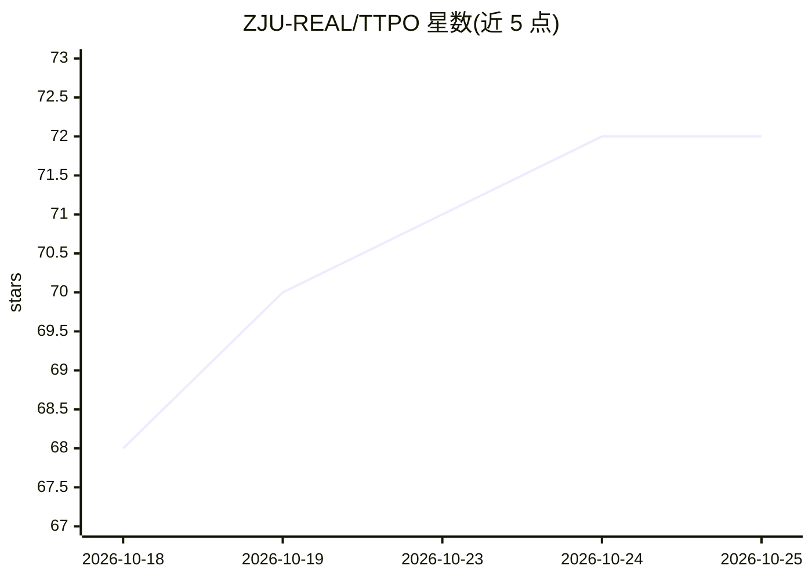

# ZJU-REAL/TTPO

⭐ 72 · Python · 推送 2026-10-02 · [GitHub](https://github.com/ZJU-REAL/TTPO) · [官网](https://zju-real.github.io/TTPO/) · 组织维护 · 中文 README

**无标签测试时策略优化训练框架，供 LLM 推理能力研究**

浙江大学与阿里巴巴团队发布的测试时训练（TTT）研究代码：在无真值标签条件下直接于未标注测试题上训练，采用非对称目标——蒸馏多数投票一致的 rollout，并通过分组强化学习惩罚不一致 rollout 中的高置信错误。README 给出基于 conda 环境的安装流程与训练/评测脚本，示例配方使用 4 GPU、LoRA 与 vLLM 共置生成，基于 OPSD 与 vLLM 构建，附 arXiv 论文。

## 筛选速览

| 维度 | 判定 | 备注 |
|---|---|---|
| AI 角色 | `ai-ecosystem` | LLM/agent 周边工具 |
| 许可风险 | `none` | — |
| 部署形态 | `library` | 以包/库形式分发 |
| 模型依赖 | local-ok | 支持本地模型 |
| 硬件要求 | — | 无带数字的原话,不猜 |
| 安装摩擦 | `low` | 无编译、无系统依赖或容器化 |
| 成熟度 | — | 结构信号不足 |

## 能力要点

- 无标签测试时训练，伪标签错误时保持稳健
- 非对称目标：蒸馏一致 rollout + 分组 RL 惩罚高置信错误
- 支持在 AIME/HMMT 等数学评测上训练与评测
- 可切换 Hugging Face 数据集，仅需含 problem 字段的 train split

## 适用场景

- 在无标注测试数据上做测试时训练实验
- 复现论文中 Qwen3 系列的训练与评测结果
- 研究无标签条件下的强化学习后训练方法

## 场景标签

`强化学习` · 领域:训练与推理

## 证据(README 行号)

> L16: We introduce **TTPO**, a label-free test-time training framework that remains robust even when majority-vote pseudo
> L96: The example recipes use four GPUs, LoRA, and colocated vLLM generation. Run the commands from the `TTPO/TTPO` direc
> L135: This work builds upon OPSD and vLLM. We sincerely thank their authors and maintainers for their open-source contri

## 星数曲线

2026-10-18 68 → 2026-10-25 72（+4）

---
*卡片 v1 · prompt 1.4 · 生成 2026-10-24 · 置信度 mid · 依据 README sha `136de354be1a` · [字段定义](../../DATASET.md)*
