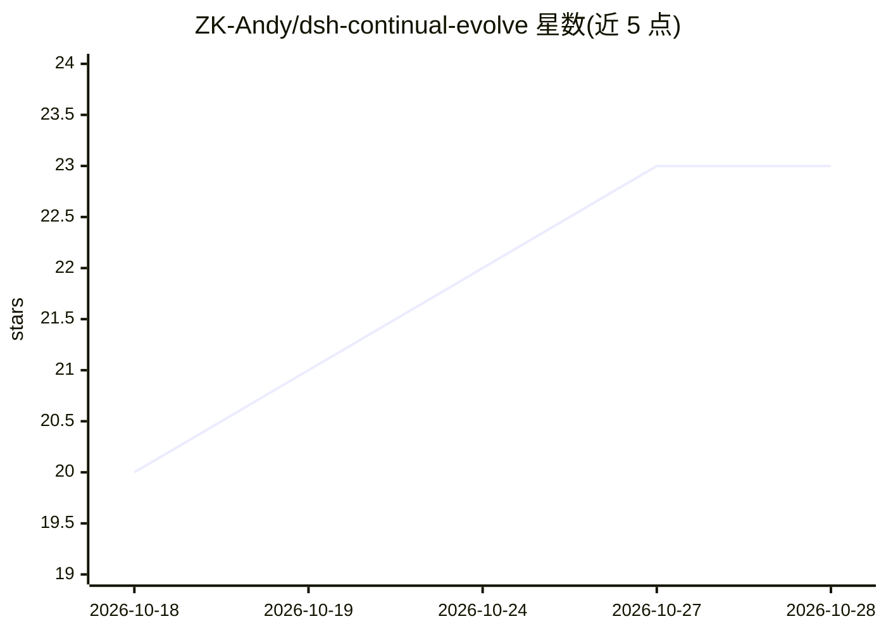

# ZK-Andy/dsh-continual-evolve

⭐ 23 · TypeScript · MIT · 推送 2026-10-20 · [GitHub](https://github.com/ZK-Andy/dsh-continual-evolve) · 个人维护 · 中文 README

**DeepSeek Harness 插件：带门禁与回滚的会话记忆自进化层**

面向 DeepSeek Harness（DSH）的 TypeScript 插件，为 AI agent 提供中央 SQLite 记忆库（~/.dsh/evolve/memory.db，按工作区分区）：会话开局注入记忆索引（token 预算、CJK 感知、超限降级），提供 evolve_write/evolve_read 两个工具；每条模型提案须在单事务内通过机械门禁（id 规范、secret 筛查、64KB 上限等）才落盘，插件代码是唯一写者。另有提案制轨迹提取、内容质量评审环（改写/隔离/归档，默认试运行）、L0/L1/L2 记忆分层与两次独立判定提级、before/after 快照回滚与巡检。需 Node ≥ 22.5，缺失时降级为 no-op。

## 筛选速览

| 维度 | 判定 | 备注 |
|---|---|---|
| AI 角色 | `ai-ecosystem` | LLM/agent 周边工具 |
| 许可风险 | `permissive` | MIT |
| 部署形态 | `library` | 以包/库形式分发 |
| 模型依赖 | — | README 未给出锁定关系 |
| 硬件要求 | — | 无带数字的原话,不猜 |
| 安装摩擦 | `low` | 无编译、无系统依赖或容器化 |
| 成熟度 | — | 结构信号不足 |

## 能力要点

- 中央 SQLite 单库、插件代码为唯一写者，安全属性不依赖模型自觉
- 开局注入索引：CJK 感知 token 预算（默认 6000）三档降级且复用保 prompt cache
- 每条提案过单事务机械门禁（secret 筛查、64KB 上限、Why/How 契约）
- 回滚靠账本：before/after 快照、孤儿 FTS 巡检、含密钥条目自动隔离

## 适用场景

- 让 agent 会话间记住我的偏好与项目做法，开局自动注入上下文
- 对模型生成的记忆做审计与回滚，避免脏数据落盘
- 把被纠正的做法物化为 SKILL.md 技能并在项目间复用

## 场景标签

`Agent 记忆` · 领域:Agent 开发

## 证据(README 行号)

> L3:  为 DeepSeek Harness 提供有治理、可自进化的记忆层。
> L19: 全部记忆与技能住在一个中央 SQLite 库里（`~/.dsh/evolve/memory.db`，按工作区路径行分区）。会话开局注入它的索引，而插件的代码是字面意义的**唯一写者**——每条模型提案都要在一个事务内过机械门禁才会

## 星数曲线

2026-10-18 20 → 2026-10-28 23（+3）

---
*卡片 v1 · prompt 1.4 · 生成 2026-10-27 · 置信度 mid · 依据 README sha `22213ae5c89b` · [字段定义](../../DATASET.md)*
