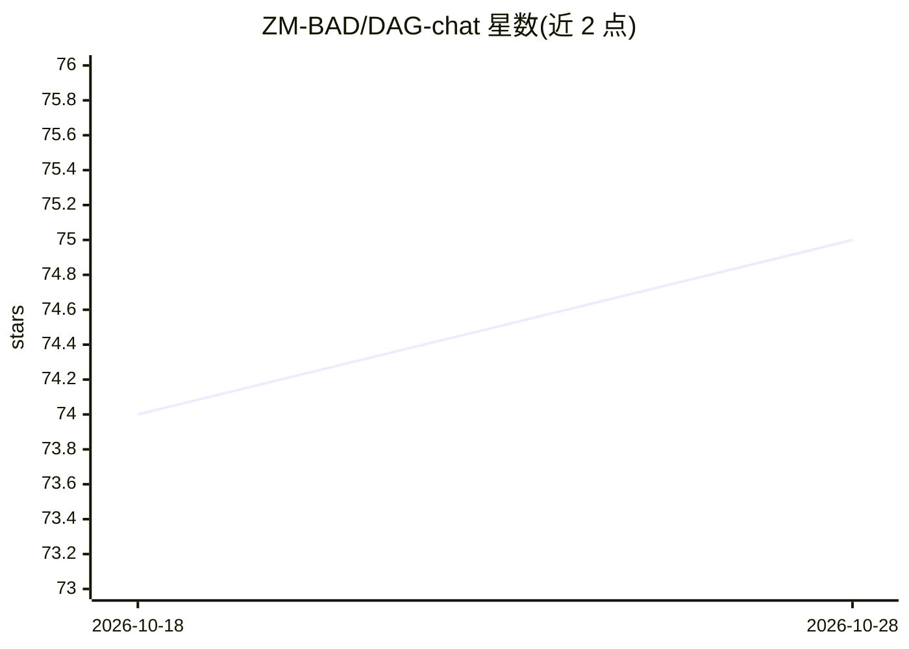

# ZM-BAD/DAG-chat

⭐ 75 · TypeScript · MIT · 推送 2026-10-28 · [GitHub](https://github.com/ZM-BAD/DAG-chat) · 个人维护 · 中文 README

**以有向无环图组织对话的网页版 LLM 聊天应用**

面向终端用户的 Web 聊天应用：将每条消息作为节点组成 DAG，支持从任意回答分支、把多条回答合并为同一问题的上下文、并行路径切换与多模型对比，全程非破坏性编辑。通过统一接口接入 GLM、Kimi、Qwen、DeepSeek、MiniMax 等 API，也可经 Ollama 本地运行模型（免 API key，自动检测已装模型），另有可选的 OrcaRouter 免费网关。前端 React 19 + TypeScript，后端 FastAPI，数据存 MySQL 与 MongoDB；提供 Docker Compose 一键部署或 uv/npm 手动启动。

## 筛选速览

| 维度 | 判定 | 备注 |
|---|---|---|
| AI 角色 | `ai-native` | 本体是模型或模型工具 |
| 许可风险 | `permissive` | MIT |
| 部署形态 | `self-host` | docker 或自建部署 |
| 模型依赖 | local-ok | 支持本地模型 |
| 硬件要求 | — | 无带数字的原话,不猜 |
| 安装摩擦 | `low` | 无编译、无系统依赖或容器化 |
| 成熟度 | — | 结构信号不足 |

## 能力要点

- 对话按 DAG 组织：任意回答可分支、多条回答可合并为共同上下文
- 统一接口多模型切换（GLM/Kimi/Qwen/DeepSeek/MiniMax）
- Ollama 本地模型支持：免 API key、自动检测已装模型
- 流式输出、深度思考模式、Markdown/LaTeX 渲染、中英双语

## 适用场景

- 对同一问题从多个角度提问并对比不同模型的回答
- 把不同分支的回答合并起来做交叉分析
- 无 API key 时用本地 Ollama 模型进行分支式对话

## 场景标签

`聊天机器人` · 领域:对话与助手

## 证据(README 行号)

> L10: *DAG-chat is a web-based LLM conversation application that organizes dialogues as Directed Acyclic Graphs — enablin
> L34: - **Multi-LLM Support** — Seamlessly switch between GLM, Kimi, Qwen, DeepSeek, MiniMax, and more through a unified 
> L35: - **Local LLM via Ollama** — Run models locally with zero API costs. Automatically detects installed Ollama models.

## 星数曲线

2026-10-18 74 → 2026-10-28 75（+1）

---
*卡片 v1 · prompt 1.4 · 生成 2026-10-24 · 置信度 high · 依据 README sha `ab478e17ae20` · [字段定义](../../DATASET.md)*
