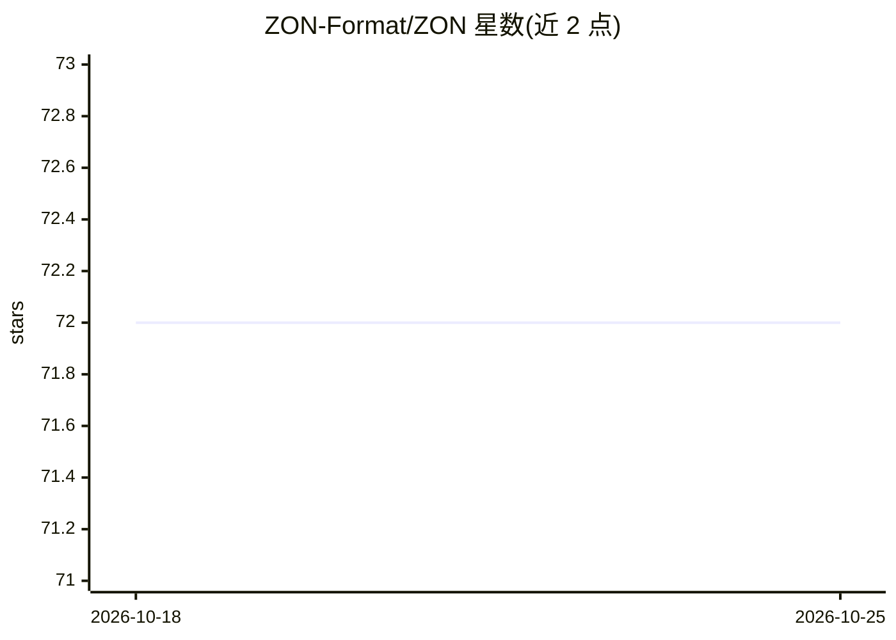

# ZON-Format/ZON

⭐ 72 · Python · MIT · 推送 2026-04-23 · [GitHub](https://github.com/ZON-Format/ZON) · [官网](https://zonformat.org/) · 组织维护

**面向 LLM 工作流的省 token 序列化格式，压缩 JSON 输入**

Python 库，提供名为 ZON 的 token 高效序列化格式：通过表格化编码、点号扁平化、单字符原语等手段压缩 JSON 数据，README 声称比 JSON 少 35-70% token 且保持数据无损往返。除文本格式外，v1.2.0 增加二进制编码（ZON-B）、文档级版本迁移、三种自适应编码模式及分析/校验工具，内置 DOS 防护限制与严格模式校验。给需要在提示词中传递结构化数据的 LLM 应用开发者使用；格式规范仍在演进中，README 自述未定稿。

## 筛选速览

| 维度 | 判定 | 备注 |
|---|---|---|
| AI 角色 | `ai-ecosystem` | LLM/agent 周边工具 |
| 许可风险 | `permissive` | MIT |
| 部署形态 | `library` | 以包/库形式分发 |
| 模型依赖 | — | README 未给出锁定关系 |
| 硬件要求 | — | 无带数字的原话,不猜 |
| 安装摩擦 | `low` | 无编译、无系统依赖或容器化 |
| 成熟度 | `idea` | |

## 能力要点

- 表格化数组与点号扁平化编码，无损往返
- 二进制格式 ZON-B（MessagePack 风格）与版本迁移系统
- compact/readable/llm-optimized 三种编码模式
- 自动 DOS 防护（100MB 文档/1M 数组等限制）与严格校验模式

## 适用场景

- 压缩送入 LLM 的结构化上下文以降低 token 开销
- 在 API 与存储中使用二进制编码传输 ZON 数据
- 对 LLM 输入数据做 schema 推断与格式分析

## 场景标签

 · 领域:LLM 基础设施/数据格式

## 证据(README 行号)

> L18: ZON is a token-efficient serialization format designed for LLM workflows. It achieves 35-50% token reduction vs JSO
> L41: AI is becoming cheaper and more accessible, but larger context windows allow for larger data inputs as well. **LLM 
> L184: 2. **Efficiency:** You need to compress inputs to save money.

## 星数曲线

2026-10-18 72 → 2026-10-25 72（+0）

---
*卡片 v1 · prompt 1.4 · 生成 2026-10-24 · 置信度 high · 依据 README sha `85dcc741dffd` · [字段定义](../../DATASET.md)*
