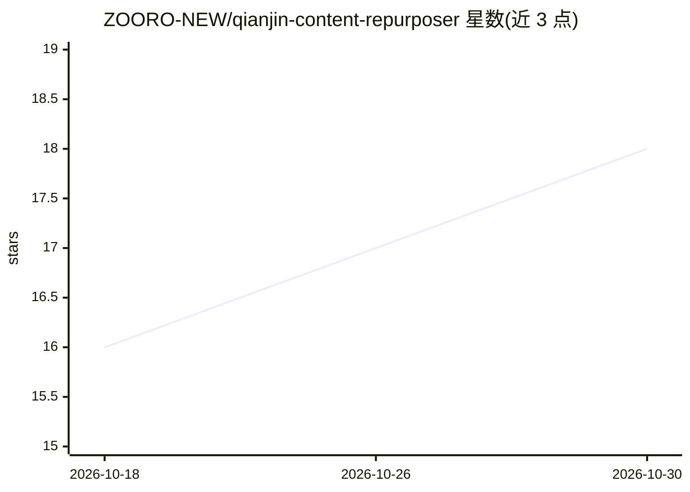

# ZOORO-NEW/qianjin-content-repurposer

⭐ 18 · MIT · 推送 2026-10-06 · [GitHub](https://github.com/ZOORO-NEW/qianjin-content-repurposer) · 个人维护 · 中文 README

**AI 写作技能包：把一篇长文改写为 6 个平台的内容版本**

面向内容创作者的提示词技能包（SKILL.md + 系统提示词），把一篇源文（长文、演讲稿、采访记录等）按各平台特性改写为公众号、小红书、抖音、知乎、B站、视频号 6 个版本，规定各平台的字数/时长与语气；小红书和公众号额外输出含 AI 生图提示词的配图方案。WorkBuddy 用户放入技能目录即可触发，其他平台可复制系统提示词使用；支持 OpenClaw/Hermes/Codex/ChatGPT/Claude/通义千问/文心一言/混元/DeepSeek。README 中含作者自述的转化效果数据，无独立验证。

## 筛选速览

| 维度 | 判定 | 备注 |
|---|---|---|
| AI 角色 | `ai-knowledge` | 知识聚合/清单类 |
| 许可风险 | `permissive` | MIT |
| 部署形态 | `None` |  |
| 模型依赖 | — | README 未给出锁定关系 |
| 硬件要求 | — | 无带数字的原话,不猜 |
| 安装摩擦 | `low` | 无编译、无系统依赖或容器化 |
| 成熟度 | — | 结构信号不足 |

## 能力要点

- 一篇源文生成 6 个平台版本，各平台有明确字数/时长与语气规格
- 小红书/公众号输出配图方案（类型、尺寸、色调、AI生图提示词）
- WorkBuddy 技能包形式，也可复制系统提示词到其他 AI 平台
- PLATFORMS.md 提供跨平台适配指南（9 个平台）

## 适用场景

- 把一篇公众号长文一次性改成多平台分发版本
- 为小红书和公众号内容生成配图方案
- 在 WorkBuddy 对话中说"一鱼多吃"触发改写

## 场景标签

`AI 写作` · 领域:内容生成

## 证据(README 行号)

> L9: 一个AI写作技能，把一篇源文（公众号长文、演讲稿、采访记录、内部文档等任何文本）一次性转化为6个平台的专业内容版本：
> L31: 将技能包放入 `~/.workbuddy/skills/content-repurposer/`，对话中说"一鱼多吃"即可触发。
> L34: 1. 打开 `prompts/system-prompt-zh.md`，全选复制

## 星数曲线

2026-10-18 16 → 2026-10-30 18（+2）

---
*卡片 v1 · prompt 1.4 · 生成 2026-10-29 · 置信度 high · 依据 README sha `de66dedbcab4` · [字段定义](../../DATASET.md)*
