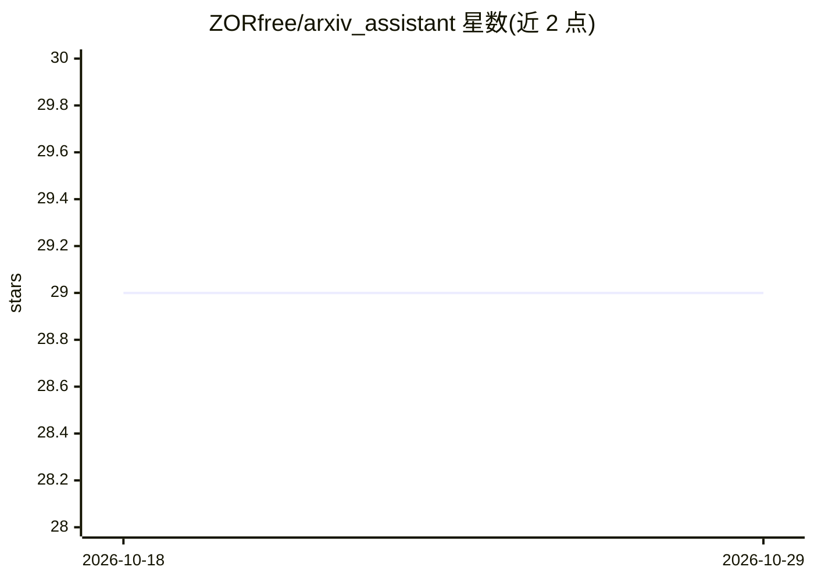

# ZORfree/arxiv_assistant

⭐ 29 · TypeScript · MIT · 推送 2026-04-03 · [GitHub](https://github.com/ZORfree/arxiv_assistant) · [官网](https://arxiv.let.tf) · 个人维护 · 中文 README

**帮助研究者筛选 ArXiv 论文的 Next.js 智能工具**

基于 Next.js 的 Web 应用，面向研究者：在 ArXiv 数据库中按关键词和分类检索论文，调用 AI 服务按用户研究偏好分析论文相关性并给出相关度评分，支持并行分析多篇论文、自动中英翻译标题与摘要。另含收藏管理系统（自定义分类、搜索、统计）、本地浏览器存储、JSON 导入导出与 WebDAV 跨设备同步。数据保存在本地，需用户自行配置 AI 服务 API 信息（支持自定义 API 配置与并发数）。通过 git clone 源码加 npm 安装运行，需 Node.js v18+。采用 MIT 许可证。

## 筛选速览

| 维度 | 判定 | 备注 |
|---|---|---|
| AI 角色 | `ai-native` | 本体是模型或模型工具 |
| 许可风险 | `permissive` | MIT |
| 部署形态 | `library` | 以包/库形式分发 |
| 模型依赖 | — | README 未给出锁定关系 |
| 硬件要求 | — | 无带数字的原话,不猜 |
| 安装摩擦 | `low` | 无编译、无系统依赖或容器化 |
| 成熟度 | — | 结构信号不足 |

## 能力要点

- 按用户研究偏好对 ArXiv 论文做 AI 相关性分析与评分
- 并行分析多篇论文并显示实时进度
- 论文标题与摘要的自动中文翻译
- 收藏分类管理与 WebDAV 跨设备同步

## 适用场景

- 研究者按兴趣方向从 ArXiv 检索并筛选相关论文
- 收藏、分类和备注感兴趣的论文并跨设备同步
- 阅读英文论文时获取标题和摘要的中文翻译

## 场景标签

`科研工具` · 领域:学习与行业

## 证据(README 行号)

> L9: - **AI辅助分析**：根据用户研究偏好自动分析论文相关性，提供相关度评分
> L89:  - 配置AI服务API信息

## 星数曲线

2026-10-18 29 → 2026-10-29 29（+0）

---
*卡片 v1 · prompt 1.4 · 生成 2026-10-26 · 置信度 high · 依据 README sha `1489425d8592` · [字段定义](../../DATASET.md)*
