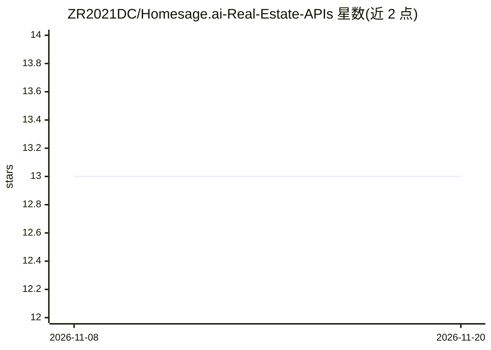

# ZR2021DC/Homesage.ai-Real-Estate-APIs

⭐ 13 · MIT · 推送 2026-11-03 · [GitHub](https://github.com/ZR2021DC/Homesage.ai-Real-Estate-APIs) · [官网](https://app.homesage.ai/docs) · 组织维护

**面向投资者/贷款方的美国房产估值与投资分析 REST API 和 MCP**

Homesage.ai 提供 160M+ 美国房产、200B+ 数据点的商业 API 服务：30+ REST 端点分 8 类，覆盖房产记录查询、估值（AVM）、条件评分、翻修成本估算、翻售与租赁回报建模、区域筛选搜索、抵押留置与业主追溯。API key 以 Bearer 头调用，返回 JSON；同时提供 MCP 端点供 Claude/ChatGPT/Gemini/Cursor 等助手以自然语言访问，MCP 路径无需 API key。按计划与 credit 计费，README 附 Python/JavaScript 示例代码。

## 筛选速览

| 维度 | 判定 | 备注 |
|---|---|---|
| AI 角色 | `ai-native` | 本体是模型或模型工具 |
| 许可风险 | `permissive` | MIT |
| 部署形态 | `None` |  |
| 模型依赖 | locked-api |  |
| 硬件要求 | — | 无带数字的原话,不猜 |
| 安装摩擦 | `low` | 无编译、无系统依赖或容器化 |
| 成熟度 | — | 结构信号不足 |

## 能力要点

- 30+ REST 端点覆盖估值、comps、翻修成本与翻售/租赁回报
- MCP 端点接入 Claude、ChatGPT、Gemini CLI、Cursor、VS Code，无需 API key
- 基于照片的房产条件评分与翻修成本分解（AI-Powered Analysis 类）
- 文档提供 .md 版本、OpenAPI 规范与 llms.txt

## 适用场景

- 查询房产估值、价值历史与条件评分
- 用 comps 与 ARV 做翻售/出租的投资回报测算
- 按价格、ROI、租金筛选城市/县/ZIP 找标的
- 在 AI 助手里用自然语言查房产数据

## 场景标签

 · 领域:房地产/金融数据服务

## 证据(README 行号)

> L8: Property data, valuations and investment analysis for 160M+ US properties and 200B+ data points. Call 30+ REST endpo
> L20: |Property condition & rehab budgeting from photos|`GET /api/properties/property-condition/`, `GET /api/properties/r
> L49: ## MCP

## 星数曲线

2026-11-08 13 → 2026-11-20 13（+0）

---
*卡片 v1 · prompt 1.4 · 生成 2026-11-18 · 置信度 high · 依据 README sha `36cb1e2aba75` · [字段定义](../../DATASET.md)*
