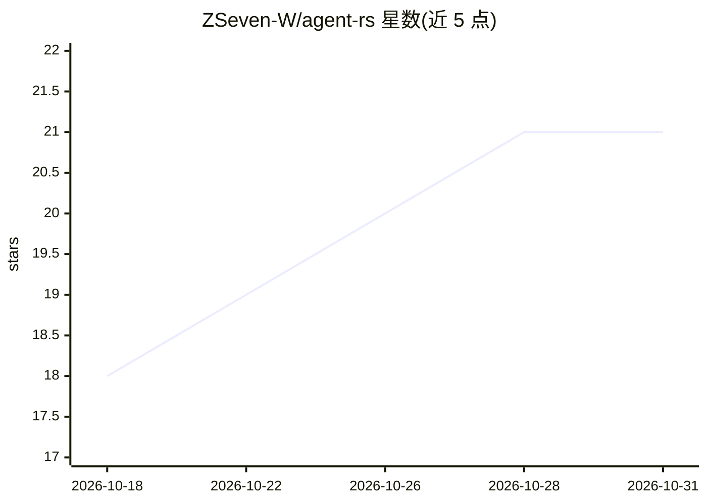

# ZSeven-W/agent-rs

⭐ 21 · Rust · MIT · 推送 2026-08-14 · [GitHub](https://github.com/ZSeven-W/agent-rs) · [官网](https://github.com/ZSeven-W/agent-rs) · 个人维护

**纯 Rust 异步 LLM agent 运行时库，供开发者构建 agent**

Library-only 的 Rust crate，面向在 CLI、IDE 插件、桌面应用或服务端中嵌入 LLM agent 的开发者。提供多提供商接入（Anthropic 手写 SSE、async-openai 兼容 DeepSeek/Groq/OpenRouter/LM Studio、本地 Ollama），统一流式 Event 词汇表；内置工具派发多轮循环、7 步权限决策链、MCP 客户端（stdio/HTTP/OAuth/PKCE）、u128 纳美元精度成本核算、Files API 与自动上下文压缩。另附可选的 agent-tools-code crate，提供文件/搜索/Bash/WebFetch 等编码工具与 WorkspacePolicy 约束。以 cargo git 依赖方式安装，全部 crate 禁用 unsafe。

## 筛选速览

| 维度 | 判定 | 备注 |
|---|---|---|
| AI 角色 | `ai-ecosystem` | LLM/agent 周边工具 |
| 许可风险 | `permissive` | MIT |
| 部署形态 | `None` |  |
| 模型依赖 | local-ok | 支持本地模型 |
| 硬件要求 | — | 无带数字的原话,不猜 |
| 安装摩擦 | `low` | 无编译、无系统依赖或容器化 |
| 成熟度 | — | 结构信号不足 |

## 能力要点

- 多提供商统一 Event 词汇表，切换后端不改工具代码
- 7 步权限决策链 + 4 级 SafetyClass 门控，Unknown 视为 Destructive
- 完整 MCP 客户端生命周期：stdio/HTTP/OAuth/PKCE、elicitation、断连修复
- u128 纳美元成本核算与自动上下文压缩（microcompact、会话记忆）

## 适用场景

- 在 Rust 应用中嵌入带工具调用与权限控制的 LLM agent
- 为 agent 接入外部 MCP 服务器与 50+ 工具的延迟发现
- 长会话场景下自动压缩上下文并跟踪 USD 成本
- 为编码 agent 挂载文件/搜索/Bash/WebFetch 工具包

## 场景标签

`Agent 框架` · 领域:Agent 开发

## 证据(README 行号)

> L3: ### A pure-Rust async runtime for shipping LLM agents.
> L45: - **🔌 Three providers, one event vocabulary.** Anthropic Messages (hand-rolled SSE — full prompt-cache + extended-t
> L204: > **Provider-agnostic at the runtime layer.** Concrete tools live outside the `agent` crate. The runtime defines t

## 星数曲线

2026-10-18 18 → 2026-10-31 21（+3）

---
*卡片 v1 · prompt 1.4 · 生成 2026-10-28 · 置信度 high · 依据 README sha `f2fbbb8737a6` · [字段定义](../../DATASET.md)*
