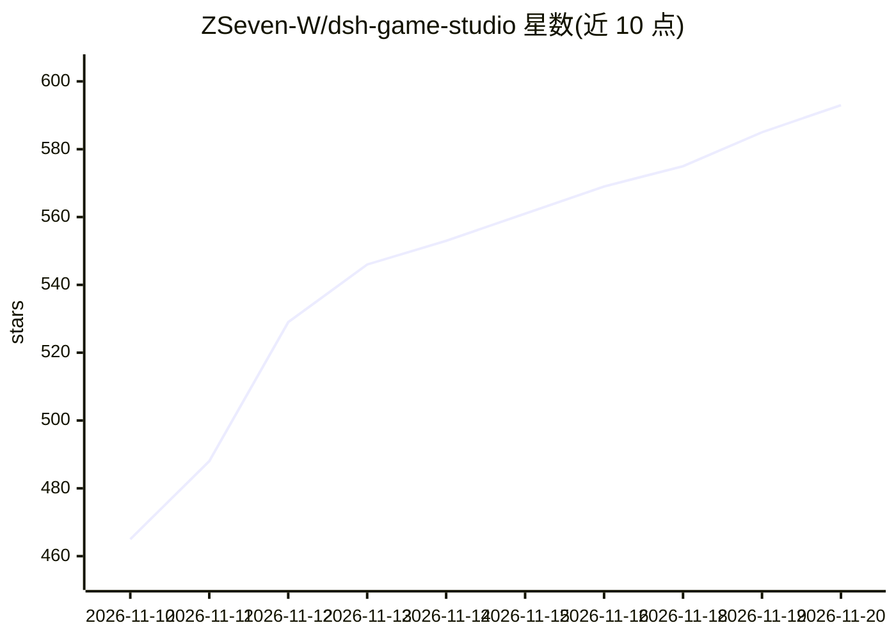

# ZSeven-W/dsh-game-studio

⭐ 593 · JavaScript · MIT · 推送 2026-11-18 · [GitHub](https://github.com/ZSeven-W/dsh-game-studio) · [官网](https://finiking.github.io/dsh-games/wall/) · 个人维护 · 中文 README

**DeepSeek Harness 插件：一句话生成可玩小游戏并导出发布**

面向 DeepSeek Harness（DSH）的 npm 插件，为 agent 提供 10 余个 game_studio_* 工具：从 2D 俯视或 3D 体素模板生成游戏、在沙箱侧边栏实时预览、用 OpenAI 或 Codex CLI 生成候选美术素材（先出费用确认卡）、headless Chrome/Edge 自动试玩回帧率与截图、版本历史、导出单一离线 HTML、经 gh CLI 发布到 GitHub Pages。要求 DSH 0.2.1+ 与 Node.js 24.11+；无图像服务密钥时游戏以代码绘制角色运行。

## 筛选速览

| 维度 | 判定 | 备注 |
|---|---|---|
| AI 角色 | `ai-ecosystem` | LLM/agent 周边工具 |
| 许可风险 | `permissive` | MIT |
| 部署形态 | `library` | 以包/库形式分发 |
| 模型依赖 | locked-api |  |
| 硬件要求 | — | 无带数字的原话,不猜 |
| 安装摩擦 | `low` | 无编译、无系统依赖或容器化 |
| 成熟度 | — | 结构信号不足 |

## 能力要点

- 2D/3D 模板一句话生成游戏，侧边栏沙箱实时可玩
- OpenAI 或 Codex 生成候选美术，花费前出审批卡
- headless Chrome/Edge 自动试玩并报告帧率、错误与截图
- 导出单文件离线 HTML，经 gh CLI 一键发布 GitHub Pages

## 适用场景

- 用一句自然语言描述就生成一个可在浏览器玩的小游戏
- 让 agent 生成美术候选图并按编号替换到游戏里
- 把做好的游戏导出单文件分享或发布成在线页面

## 场景标签

`代码生成` · 领域:编码与开发

## 证据(README 行号)

> L5:  Describe a small game in one sentence — play it in the sidebar of a DeepSeek Harness conversation, swap in AI art, 
> L62: |`game_studio_create`|Create a playable game from the `collector` (2D) or `voxel` (3D) template, build it and show 

## 星数曲线

2026-11-10 465 → 2026-11-20 593（+128）

---
*卡片 v1 · prompt 1.4 · 生成 2026-11-17 · 置信度 high · 依据 README sha `7b05b21bc354` · [字段定义](../../DATASET.md)*
