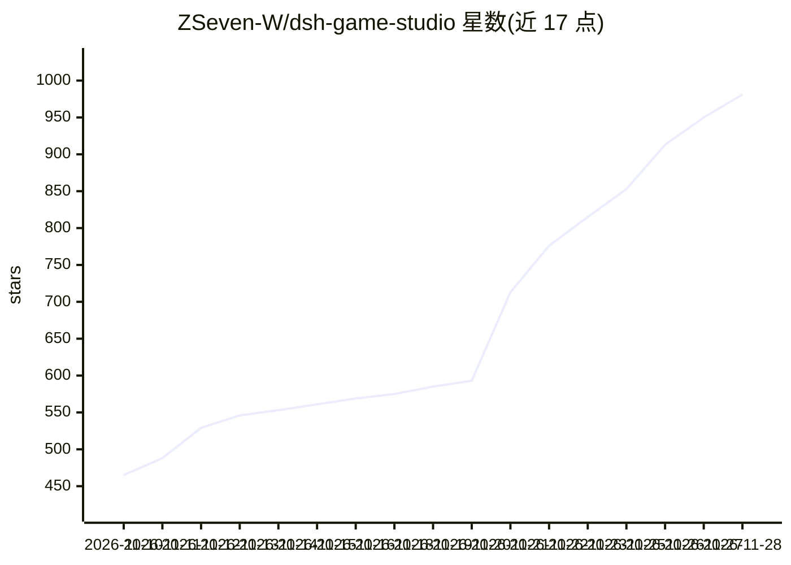

# ZSeven-W/dsh-game-studio

⭐ 981 · JavaScript · MIT · 推送 2026-11-21 · [GitHub](https://github.com/ZSeven-W/dsh-game-studio) · [官网](https://finiking.github.io/dsh-games/wall/) · 个人维护 · 中文 README

**给 agent 用户的 AI 小游戏生成插件：一句话生成可玩游戏**

以 DeepSeek Harness / Codex / Claude Code 等 agent 宿主的插件形式运行，提供 15 个工具：从一句话描述基于 2D/3D voxel 模板生成游戏，沙箱侧边栏实时预览，headless Chrome/Edge 自动试玩并报告帧率与错误，生成带费用审批卡的 AI 美术候选并按编号应用，支持版本历史回滚、单文件离线 HTML 导出、微信小游戏（<4MB）导出与 CLI 上传、Cloudflare 临时分享链接及 GitHub Pages 一键发布。游戏角色默认代码绘制，无 OpenAI key 或 Codex 时仍可生成。

## 筛选速览

| 维度 | 判定 | 备注 |
|---|---|---|
| AI 角色 | `ai-native` | 本体是模型或模型工具 |
| 许可风险 | `permissive` | MIT |
| 部署形态 | `library` | 以包/库形式分发 |
| 模型依赖 | locked-api |  |
| 硬件要求 | — | 无带数字的原话,不猜 |
| 安装摩擦 | `low` | 无编译、无系统依赖或容器化 |
| 成熟度 | `idea` | |

## 能力要点

- 15 个 agent 工具：生成、构建、试玩、美术、版本、导出、分享、发布
- headless 浏览器自动试玩，报告关卡、得分、fps、脚本错误与截图
- AI 美术生成前显示费用审批卡，支持 OpenAI API 或本地 Codex CLI
- 微信小游戏导出（<4MB，含 WebGL2/Canvas2D 适配器）与 GitHub Pages 发布

## 适用场景

- 用一句话描述让 agent 生成一个可玩的 2D/3D 小游戏
- 给游戏换上 AI 生成的美术素材再导出发布
- 把做好的小游戏发布到 GitHub Pages 或打包成微信小游戏

## 场景标签

`代码生成` `图像生成` · 领域:编码与开发

## 证据(README 行号)

> L5:  Describe a small game in one sentence — play it in the DeepSeek Harness sidebar or build it in Codex / Claude Code 
> L21: Ask the agent for a game in plain words — "a 3D game: a red panda collects bamboo shoots in a forest and dodges wil
> L100: - DeepSeek Harness `0.2.1` or later (web or desktop), Node.js `24.11` or later.

## 星数曲线

2026-11-10 465 → 2026-11-28 981（+516）

---
*卡片 v1 · prompt 1.4 · 生成 2026-11-24 · 置信度 high · 依据 README sha `b13b47a47299` · [字段定义](../../DATASET.md)*
