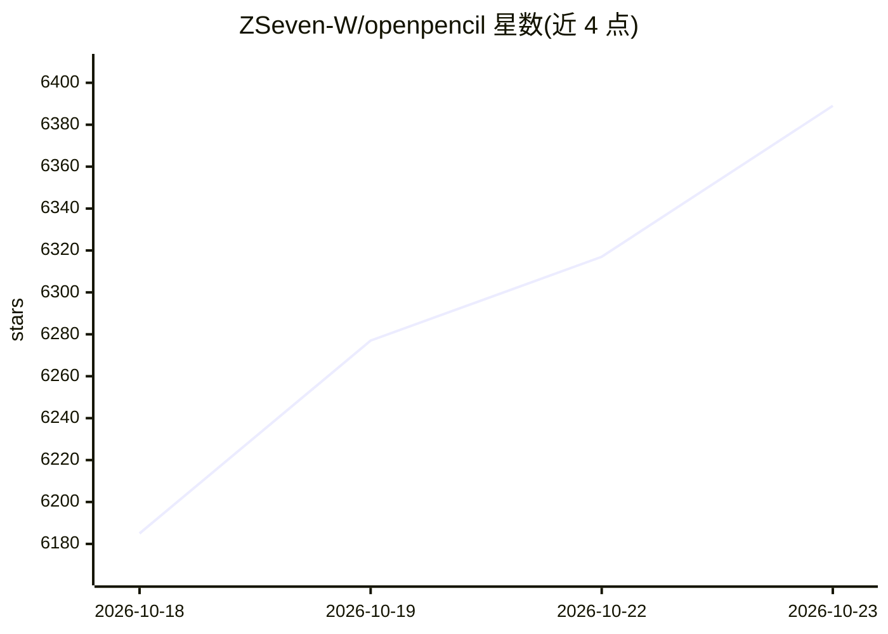

# ZSeven-W/openpencil

⭐ 6,389 · Rust · MIT · 推送 2026-10-22 · [GitHub](https://github.com/ZSeven-W/openpencil) · [官网](https://op.zseven.tech) · 个人维护 · 中文 README

**开源 AI 原生矢量设计工具：自然语言生成 UI 并并发多 Agent 协作**

AI 原生矢量设计工具，用 Rust 实现单一自包含内核，同时提供 Web 版与 macOS/Windows/Linux 桌面版。核心机制：自然语言提示在无限画布上实时流式生成 UI；编排器将复杂页面拆解为空间子任务，多个 AI Agent 并行处理不同区块；.op 设计文件为 JSON 格式，可导出 React+Tailwind、Flutter、SwiftUI 等多种代码。内置 MCP Server，可被 Claude Code、Codex、OpenCode 等 CLI 接入；支持 9+ 模型供应商预设及按模型能力分级适配提示词。限制：Web 版仅支持内置 API-key agent，Docker 镜像不捆绑 Claude/Codex 等 CLI 工具。

## 筛选速览

| 维度 | 判定 | 备注 |
|---|---|---|
| AI 角色 | `ai-native` | 本体是模型或模型工具 |
| 许可风险 | `permissive` | MIT |
| 部署形态 | `desktop` | 安装包/桌面程序 |
| 模型依赖 | locked-api |  |
| 硬件要求 | — | 无带数字的原话,不猜 |
| 安装摩擦 | `low` | 无编译、无系统依赖或容器化 |
| 成熟度 | — | 结构信号不足 |

## 能力要点

- 自然语言提示在画布上实时流式生成 UI，可选中元素用语言修改
- 并发 Agent Teams：编排器拆解空间子任务，多 Agent 并行生成不同区块
- .op 文件为 JSON（可 diff、Git 友好），可导出 React/Vue/Flutter/SwiftUI 等多平台代码
- 内置 MCP Server，一键安装到 Claude Code、Codex、OpenCode 等 CLI
- 基于 P2P 的实时协作，带配对码、远程光标与冲突回放

## 适用场景

- 用自然语言快速生成并迭代 UI 设计稿
- 从设计文件直接导出多平台前端代码
- 在 Claude Code 等终端 Agent 中通过 MCP 读写设计文件
- 多人实时协作编辑同一画布

## 场景标签

`多智能体` `代码生成` · 领域:Agent 开发

## 证据(README 行号)

> L5:  The world's first open-source AI-native vector design tool.
> L261: - **Text-to-design** — describe a page, get it generated on canvas in real-time with SSE streaming animation
> L263: - **Agent Teams** — concurrent team members with delegate tool, per-member canvas indicators, and fallback strateg

## 星数曲线

2026-10-18 6,185 → 2026-10-23 6,389（+204）

---
*卡片 v1 · prompt 1.4 · 生成 2026-10-20 · 置信度 high · 依据 README sha `80c471ce42a1` · [字段定义](../../DATASET.md)*
