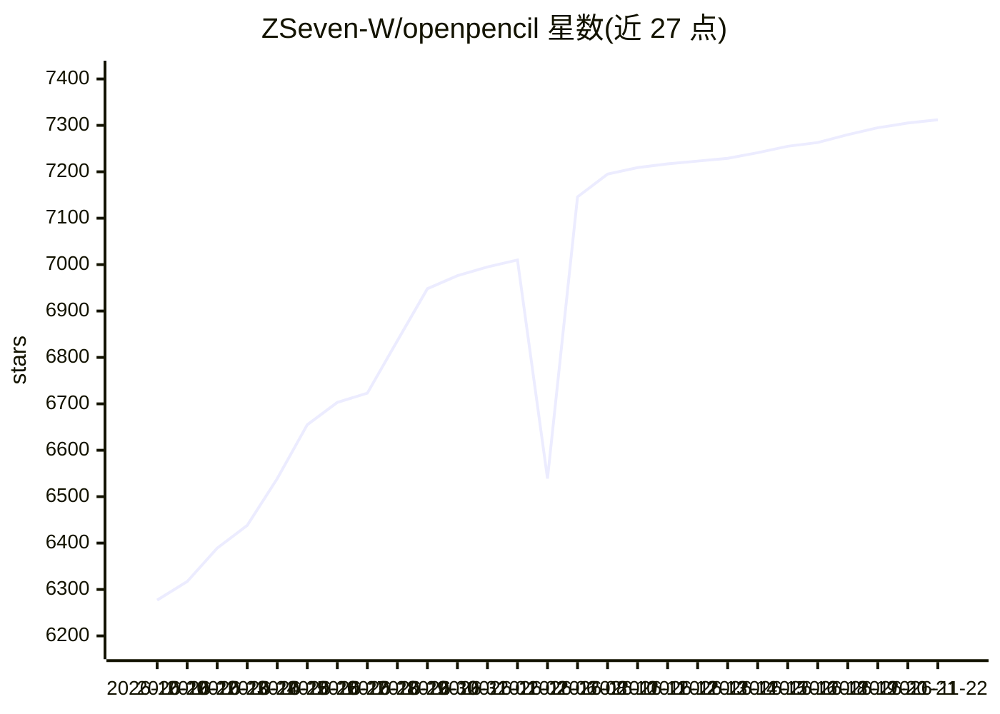

# ZSeven-W/openpencil

⭐ 7,312 · Rust · MIT · 推送 2026-11-21 · [GitHub](https://github.com/ZSeven-W/openpencil) · [官网](https://op.zseven.tech) · 个人维护 · 中文 README

**面向设计师与开发者的 AI 原生矢量设计工具**

开源矢量设计工具，支持自然语言描述 UI 并实时生成到无限画布，支持选中元素后对话式修改设计。采用并发 Agent Teams 机制：编排器将复杂页面分解为空间子任务，多个 agent 并行生成不同区域。.op 文件为 JSON 格式，可 Git 管理，并导出为 React + Tailwind、HTML + CSS、Vue、Svelte、Flutter、SwiftUI 等多平台代码。提供 Web 应用与 macOS/Windows/Linux 原生桌面应用，内置 MCP Server 可接入 Claude Code/Codex 等 CLI agent，附带 op 命令行工具与实时协作功能。

## 筛选速览

| 维度 | 判定 | 备注 |
|---|---|---|
| AI 角色 | `ai-native` | 本体是模型或模型工具 |
| 许可风险 | `permissive` | MIT |
| 部署形态 | `desktop` | 安装包/桌面程序 |
| 模型依赖 | locked-api |  |
| 硬件要求 | — | 无带数字的原话,不猜 |
| 安装摩擦 | `low` | 无编译、无系统依赖或容器化 |
| 成熟度 | `idea` | |

## 能力要点

- Prompt → Canvas：自然语言生成 UI 并流式实时呈现，支持截图参考输入
- 并发 Agent Teams：编排器分解子任务，多 agent 并行生成
- Design-as-Code：.op JSON 文件可 diff，导出 React/Vue/Flutter/SwiftUI 等多平台代码
- 内置 MCP Server（op-mcp），可接入 Claude Code / Codex / OpenCode 等 CLI agent

## 适用场景

- 用自然语言在画布上直接生成和迭代 UI 设计
- 将 .op 设计稿导出为 React/Vue/Flutter 等前端代码
- 通过终端 MCP agent 自动化读取与修改设计文件
- 多人实时协作编辑设计

## 场景标签

`多智能体` · 领域:Agent 开发

## 证据(README 行号)

> L27: Describe any UI in natural language. Watch it appear on the infinite canvas in real-time with streaming animation. 
> L39: One-click install into Claude Code, Codex, OpenCode, Kiro, or Copilot CLIs. Design from your terminal — read, creat
> L239: - **Text-to-design** — describe a page, get it generated on canvas in real-time with SSE streaming animation

## 星数曲线

2026-10-20 6,277 → 2026-11-22 7,312（+1,035）

---
*卡片 v1 · prompt 1.4 · 生成 2026-11-22 · 置信度 high · 依据 README sha `94a8f2f00740` · [字段定义](../../DATASET.md)*
