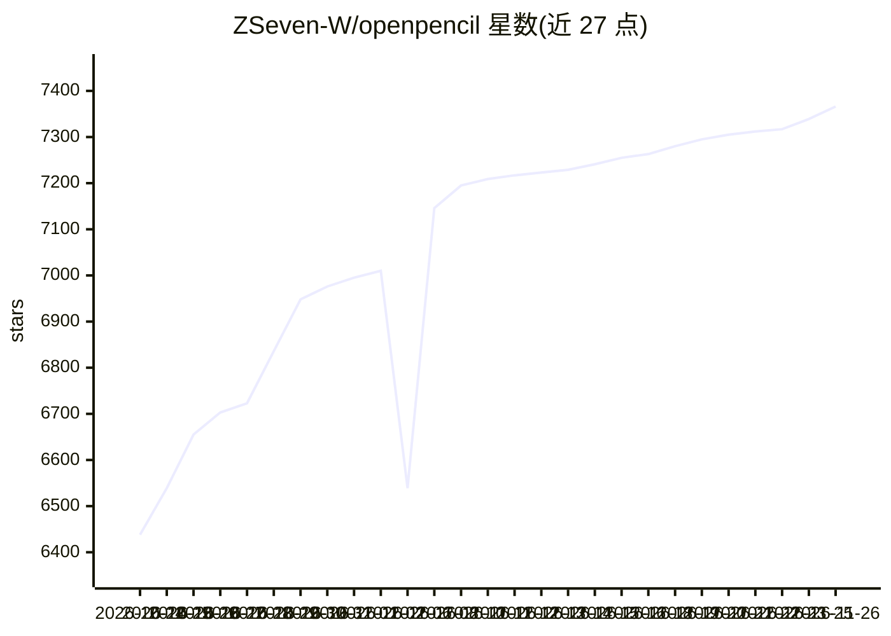

# ZSeven-W/openpencil

⭐ 7,366 · Rust · MIT · 推送 2026-11-25 · [GitHub](https://github.com/ZSeven-W/openpencil) · [官网](https://op.zseven.tech) · 个人维护 · 中文 README

**开源 AI 向量设计工具：提示词直接在画布生成 UI**

以 Rust 为核心的向量设计工具，支持自然语言描述 UI 并在无限画布上实时流式生成，可选中元素后对话式修改。编排器将复杂页面拆分为空间子任务，多个 agent 并行处理各区域。`.op` 设计文件为 JSON 格式，可导出为 React/Vue/Flutter/SwiftUI 等多种平台代码；内置 MCP 服务器可接入外部 agent；支持 P2P 实时协作。提供 Web、桌面应用（macOS/Windows/Linux）与 CLI。

## 筛选速览

| 维度 | 判定 | 备注 |
|---|---|---|
| AI 角色 | `ai-native` | 本体是模型或模型工具 |
| 许可风险 | `permissive` | MIT |
| 部署形态 | `desktop` | 安装包/桌面程序 |
| 模型依赖 | locked-api |  |
| 硬件要求 | — | 无带数字的原话,不猜 |
| 安装摩擦 | `low` | 无编译、无系统依赖或容器化 |
| 成熟度 | `idea` | |

## 能力要点

- Prompt→Canvas：自然语言在画布上实时流式生成与修改设计
- Concurrent Agent Teams：编排器拆分子任务，多 agent 并行生成
- `.op` JSON 文件支持 Git diff，可导出 8+ 平台代码
- 内置 MCP 服务器，可接入 Claude Code/Codex/OpenCode 等 CLI agent

## 适用场景

- 用自然语言快速生成页面初稿并在画布上迭代修改
- 把设计文件导出为 React/Flutter/SwiftUI 等平台代码
- 在终端通过 MCP agent 自动化读取与修改设计文件
- 多人通过配对码进行实时协作设计

## 场景标签

`多智能体` · 领域:Agent 开发

## 证据(README 行号)

> L27: Describe any UI in natural language. Watch it appear on the infinite canvas in real-time with streaming animation. 
> L31: The orchestrator decomposes complex pages into spatial sub-tasks. Multiple AI agents work on different sections sim
> L254: |**Built-in (9+ providers)**|Select from provider presets with region switcher — Anthropic, OpenAI, Google, DeepSe

## 星数曲线

2026-10-24 6,438 → 2026-11-26 7,366（+928）

---
*卡片 v1 · prompt 1.4 · 生成 2026-11-23 · 置信度 high · 依据 README sha `c7a8ae3676c8` · [字段定义](../../DATASET.md)*
