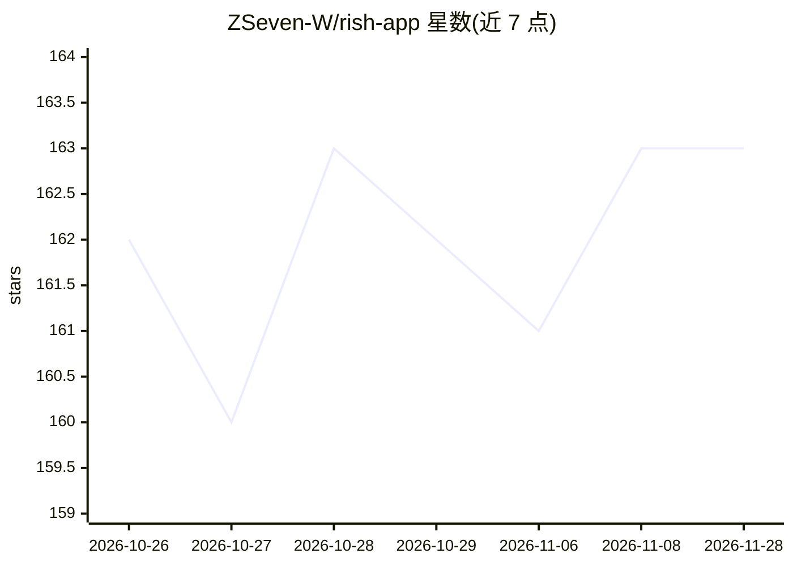

# ZSeven-W/rish-app

⭐ 163 · Objective-C++ · MIT · 推送 2026-11-09 · [GitHub](https://github.com/ZSeven-W/rish-app) · 个人维护 · 中文 README

**iOS/Android 本地优先移动 AI agent 应用：对话+工作区**

Rish 是一个实验性原生移动应用，提供对话与本地工作区：Rust+GPUI 编写界面，支持多模型配置（模型目录来自所配置的服务端）、会话保存、文件夹与 UTF-8 文件创建编辑（上限 256 KiB）、Git 与运行时执行等原生服务，凭据由原生平台服务托管。定位为 pocket agent，但 README 声明完整 Agent 控制器、工具审批流程、附件与完整设置尚未完成，属于开发预览；需从源码构建，无已验证的签名发布。

## 筛选速览

| 维度 | 判定 | 备注 |
|---|---|---|
| AI 角色 | `ai-native` | 本体是模型或模型工具 |
| 许可风险 | `permissive` | MIT |
| 部署形态 | `None` |  |
| 模型依赖 | — | README 未给出锁定关系 |
| 硬件要求 | — | 无带数字的原话,不猜 |
| 安装摩擦 | `low` | 无编译、无系统依赖或容器化 |
| 成熟度 | `idea` | |

## 能力要点

- iOS/Android 原生应用，Rust+GPUI 界面，macOS 预览版
- 本地工作区：文件夹/文本文件编辑、Git 与运行时执行服务
- 模型目录来自所配置服务，无内置模型与自动回退
- 会话变更经共享 Rust 校验器与 compare-and-swap 机制

## 适用场景

- 在手机上通过配置的服务端模型进行对话
- 在移动端管理本地工作区文件与 Git 仓库
- 跟踪 GPUI 迁移进度并参与开发预览测试

## 场景标签

`AI 助手` `聊天机器人` · 领域:对话与助手

## 证据(README 行号)

> L7: Rish is an experimental native app for conversations and local workspaces. Its
> L26: This is a development preview. **The full Agent controller and tool workflows,
> L64: Model requests send conversation/task context to the configured service.

## 星数曲线

2026-10-26 162 → 2026-11-28 163（+1）

---
*卡片 v1 · prompt 1.4 · 生成 2026-11-27 · 置信度 high · 依据 README sha `83b031a0ccee` · [字段定义](../../DATASET.md)*
