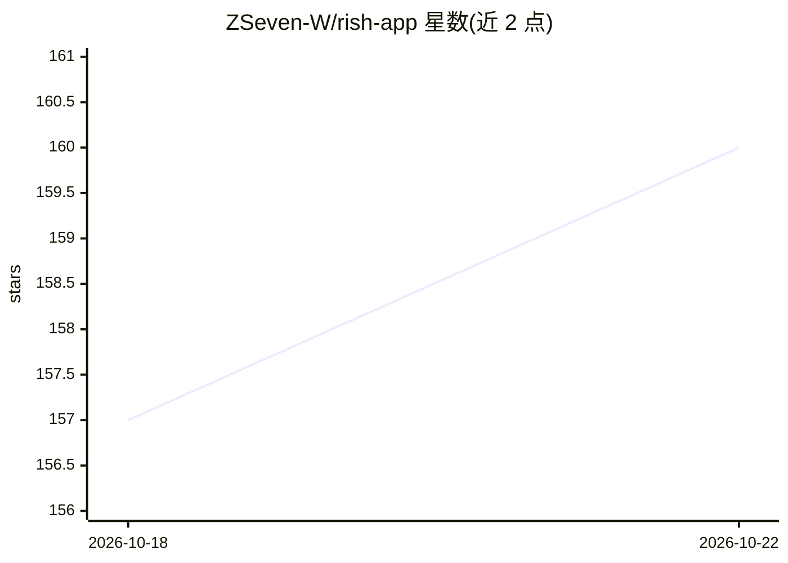

# ZSeven-W/rish-app

⭐ 160 · Objective-C++ · MIT · 推送 2026-09-29 · [GitHub](https://github.com/ZSeven-W/rish-app) · 个人维护 · 中文 README

**iOS/Android 上的本地优先 AI agent 应用：手机上运行对话、工作区与工具执行**

面向手机用户的 agent 应用：在手机本地工作区中导入文件、运行对话、执行工具，需授权的操作先询问，可查看 Git diff 与执行记录。模型侧通过内置适配器接入 DSH/DeepSeek、Claude Code、Codex、GLM，或自定义 API 服务；本地执行不等于离线推理，模型请求发送到所配置的云端服务。iOS 支持对话、附件、Git 与受控工具，Android 目前仅原生 API 聊天，本地 Agent 执行尚未提供。尚无稳定安装版，需从源码构建；另含实验性 Linux Guest（来自 rish 项目）。

## 筛选速览

| 维度 | 判定 | 备注 |
|---|---|---|
| AI 角色 | `ai-native` | 本体是模型或模型工具 |
| 许可风险 | `permissive` | MIT |
| 部署形态 | `None` |  |
| 模型依赖 | locked-api |  |
| 硬件要求 | — | 无带数字的原话,不猜 |
| 安装摩擦 | `low` | 无编译、无系统依赖或容器化 |
| 成熟度 | `idea` | |

## 能力要点

- 四条内置模型连接：DSH/DeepSeek、Claude Code、Codex、GLM，另支持自定义 API 服务
- 有界工作区内的工具执行与审批机制，可查看 Git 状态与 diff
- 实验性 Linux Guest（来自纯 Rust 的 rish x86-64 解释器项目）
- 凭证存储在原生安全存储中

## 适用场景

- 在手机上让 agent 阅读导入的文本/PDF 并整理要点
- 手机上检查项目 Git 状态与 diff，编辑文件并批准提交
- 选用不同模型服务（DeepSeek/GLM/Claude Code/Codex）执行任务

## 场景标签

`AI 助手` · 领域:对话与助手

## 证据(README 行号)

> L23: Rish brings Agent conversations, workspaces, and tool execution to your phone.
> L130: Phone workspace ← Local tools ← Rish validation and approval

## 星数曲线

2026-10-18 157 → 2026-10-22 160（+3）

---
*卡片 v1 · prompt 1.4 · 生成 2026-10-22 · 置信度 high · 依据 README sha `9505c284b9cb` · [字段定义](../../DATASET.md)*
