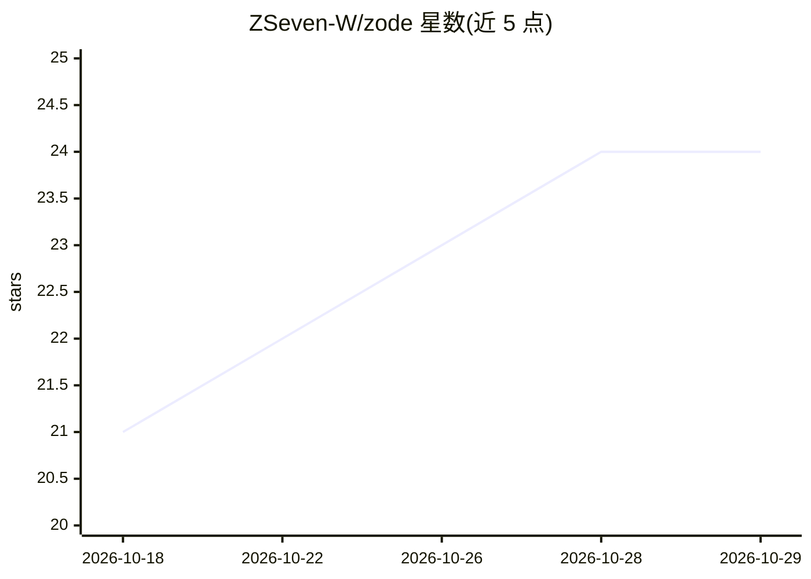

# ZSeven-W/zode

⭐ 24 · Rust · MIT · 推送 2026-09-26 · [GitHub](https://github.com/ZSeven-W/zode) · 个人维护 · 中文 README

**终端 AI 编程助手 CLI：多模型接入、插件与沙箱执行**

Rust 编写的全屏 TUI 终端编程助手，读取代码、执行命令、搜索文件、管理 git。支持 Anthropic、OpenAI 及 OpenAI 兼容 API（DeepSeek、Moonshot、OpenRouter）与本地 Ollama，可配置 1M 上下文。内置浏览器控制工具（驱动 Chromium 或真实 Chrome）、OS 级沙箱（macOS sandbox-exec / Linux bwrap，默认拒绝出网）、多会话标签页、子代理与外部 CLI 队友协作、MCP 与 SKILL.md 技能加载，并提供 headless JSON 输出与 ACP over stdio 的自动化接口。预编译二进制覆盖三平台，或以 cargo 从源码构建（需 Rust 1.88+，agent 运行时在 git 子模块中）。

## 筛选速览

| 维度 | 判定 | 备注 |
|---|---|---|
| AI 角色 | `ai-native` | 本体是模型或模型工具 |
| 许可风险 | `permissive` | MIT |
| 部署形态 | `desktop` | 安装包/桌面程序 |
| 模型依赖 | local-ok | 支持本地模型 |
| 硬件要求 | — | 无带数字的原话,不猜 |
| 安装摩擦 | `medium` | 含编译或系统依赖之一 |
| 成熟度 | `idea` | |

## 能力要点

- 多 provider 接入：Anthropic、OpenAI 兼容 API、本地 Ollama，支持 1M 上下文
- 默认开启的 OS 沙箱（sandbox-exec/bwrap，默认拒绝出网）与非阻塞权限提示
- 内置浏览器控制工具（Chromium/Chrome 桥接扩展）
- 子代理、外部 CLI 队友（claude/codex/cursor 等 9 种预设）与 MCP/Skills 支持

## 适用场景

- 在终端里让 AI 读代码、改文件、跑命令并管理 git
- 编排多个 AI 代理或外部 agent CLI 协作完成任务
- 以 headless JSON 模式接入脚本与自动化流水线

## 场景标签

`编码 Agent` `多智能体` · 领域:Agent 开发

## 证据(README 行号)

> L9:  Open-source, AI-native coding assistant for your terminal.
> L10:  Reads your code. Runs commands. Searches files. Manages git. All from a fast Rust TUI.
> L30: - **Multi-provider** — Anthropic, OpenAI, and any OpenAI-compatible API (DeepSeek, Moonshot, OpenRouter dialects), 

## 星数曲线

2026-10-18 21 → 2026-10-29 24（+3）

---
*卡片 v1 · prompt 1.4 · 生成 2026-10-27 · 置信度 high · 依据 README sha `b9f25dda5e4d` · [字段定义](../../DATASET.md)*
