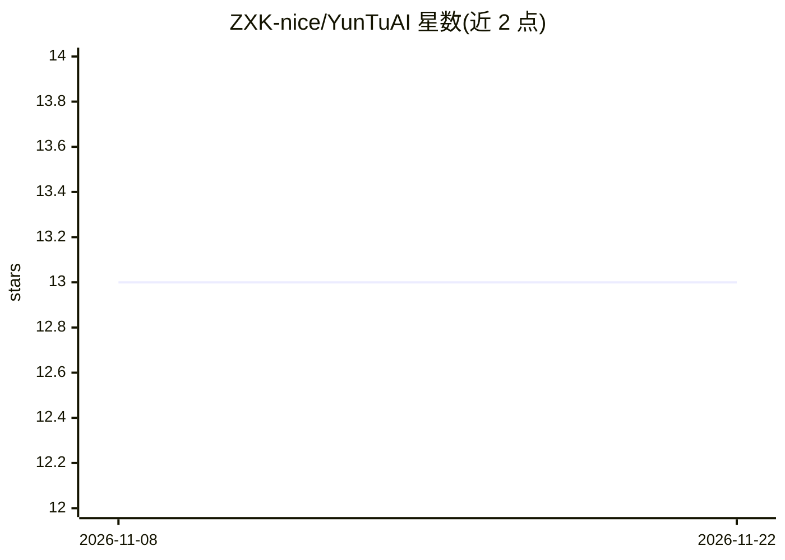

# ZXK-nice/YunTuAI

⭐ 13 · TypeScript · MIT · 推送 2026-11-05 · [GitHub](https://github.com/ZXK-nice/YunTuAI) · [官网](https://github.com/ZXK-nice/YunTuAI) · 组织维护 · 中文 README

**面向个人用户的 AI 桌面控制中心：多 Agent、技能安装与本地会话**

基于 Tauri 2 + React 19 + Rust 的 Windows/macOS 桌面应用展示版仓库：单窗口内提供多 Agent 创建与调度、80+ 内置工具技能的搜索安装（SKILL.md 生成）、本地 SQLite 会话持久化、本地 RAG 桥接与本地 OCR/PDF 处理，并内置网关守护进程（健康检查、断线重连、自动拉起）。仓库保留完整源码，但移除了随包分发的运行时二进制与安装包产物，需本地构建运行。

## 筛选速览

| 维度 | 判定 | 备注 |
|---|---|---|
| AI 角色 | `ai-native` | 本体是模型或模型工具 |
| 许可风险 | `permissive` | MIT |
| 部署形态 | `library` | 以包/库形式分发 |
| 模型依赖 | — | README 未给出锁定关系 |
| 硬件要求 | — | 无带数字的原话,不猜 |
| 安装摩擦 | `low` | 无编译、无系统依赖或容器化 |
| 成熟度 | — | 结构信号不足 |

## 能力要点

- 多 Agent 指挥中心：独立会话数、技能数与沙箱开关
- 技能工坊提供 80+ 内置工具，支持搜索安装与 SKILL.md 生成
- 网关守护状态机：establish→healthy→degraded→reconnect，崩溃后自动拉起
- 本地完成 OCR 与 PDF/Excel/Office 写入，原件不上传

## 适用场景

- 在一个桌面窗口里创建并切换多个 AI Agent 处理不同任务
- 为 Agent 搜索安装工具技能扩展能力
- 在本地管理会话记录并处理文档（OCR、PDF）

## 场景标签

`多智能体` `AI 助手` · 领域:Agent 开发

## 证据(README 行号)

> L9: **一个面向 Windows / macOS 的 AI 桌面控制中心** — Tauri 2 + React 19 + Rust 实现，单窗口承载多 Agent 调度、技能（Skill）安装、本地会话持久化与网关守护。
> L21: |**对话工作台**|多模型切换（DeepSeek / 火山方舟 / 小米 MiMo 等），支持附件、长任务、语音输入|
> L22: |**Agent 指挥中心**|多 Agent 的创建、切换、状态总览；每个 Agent 独立会话数、技能数与沙箱开关|

## 星数曲线

2026-11-08 13 → 2026-11-22 13（+0）

---
*卡片 v1 · prompt 1.4 · 生成 2026-11-18 · 置信度 high · 依据 README sha `4166f2c6ba54` · [字段定义](../../DATASET.md)*
