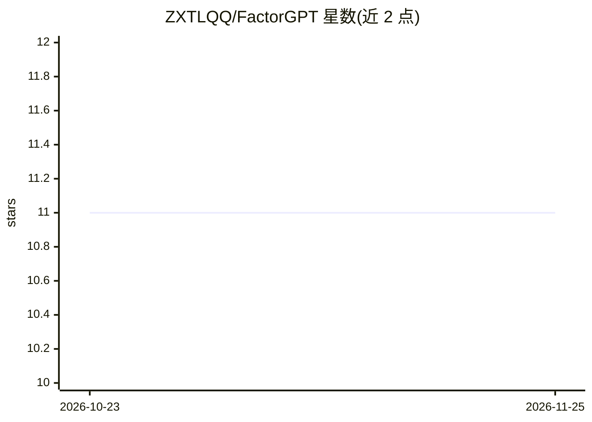

# ZXTLQQ/FactorGPT

⭐ 11 · Python · MIT · 推送 2026-09-26 · [GitHub](https://github.com/ZXTLQQ/FactorGPT) · 个人维护 · 中文 README

**面向量化研究者的 LLM 驱动因子挖掘与回测平台**

以自然语言驱动的量化因子工业化平台：用户输入投资想法，LangGraph 编排的 Agent 在检索（ChromaDB+BGE，jieba 兜底）→生成→沙箱验证→回测评估→反思改进的闭环中生成并验证因子代码。内置六阶段因子精炼流水线、62 个传统因子库、增强遗传编程（因子簇/岛屿模型/事件窗口），支持从文本、图片、PDF、表格等非结构化数据提取 Alpha 信号。提供 Streamlit 仪表盘、Docker 部署、HuggingFace Spaces 在线演示与离线合成数据模式。

## 筛选速览

| 维度 | 判定 | 备注 |
|---|---|---|
| AI 角色 | `ai-native` | 本体是模型或模型工具 |
| 许可风险 | `permissive` | MIT |
| 部署形态 | `self-host` | docker 或自建部署 |
| 模型依赖 | local-ok | 支持本地模型 |
| 硬件要求 | — | 无带数字的原话,不猜 |
| 安装摩擦 | `low` | 无编译、无系统依赖或容器化 |
| 成熟度 | — | 结构信号不足 |

## 能力要点

- LangGraph 编排的 Retrieve→Generate→Validate→Evaluate→Reflect 因子挖掘闭环
- 沙箱执行：白名单导入、AST 前视偏差检测、超时/内存限制
- 内置 62 个传统因子库，支持搜索与批量导出
- 支持上传图片/文本/PDF/表格做非结构化因子挖掘

## 适用场景

- 用自然语言描述投资想法并自动生成、回测因子代码
- A 股多因子模型的批量挖掘与组合优化
- 从研报、新闻等文本数据中提取 Alpha 信号
- 离线环境下用合成数据演示完整因子流水线

## 场景标签

`金融量化` · 领域:学习与行业

## 证据(README 行号)

> L12: **FactorGPT** is an LLM-powered intelligent financial factor industrialization platform that deeply integrates natu
> L24: 1. **Natural Language to Factor Code**: Describe your investment idea in plain language, and the LLM Agent generate
> L30: 4. **Multi-Model Support**: Works with DeepSeek, OpenAI, Qwen, local Ollama models, and any OpenAI-compatible endpo

## 星数曲线

2026-10-23 11 → 2026-11-25 11（+0）

---
*卡片 v1 · prompt 1.4 · 生成 2026-11-18 · 置信度 high · 依据 README sha `a02ea143c762` · [字段定义](../../DATASET.md)*
