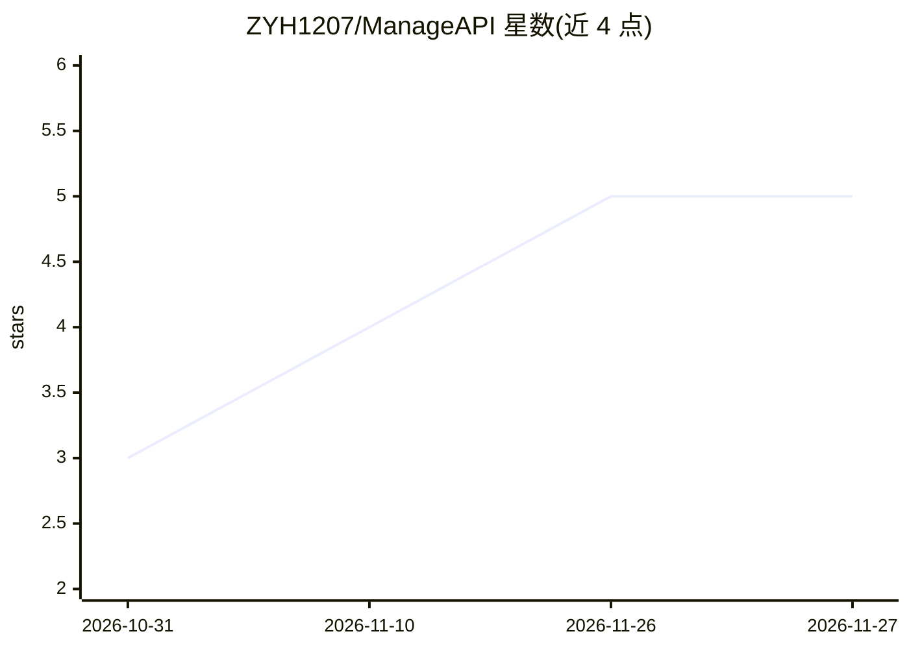

# ZYH1207/ManageAPI

⭐ 5 · JavaScript · MIT · 推送 2026-11-24 · [GitHub](https://github.com/ZYH1207/ManageAPI) · 个人维护 · 中文 README

**面向多 API 中转站用户的本地比价、探针与统一网关**

零依赖的 Node 本地网关：用户把多个 AI 中转站的地址和 Key 添加进来后，工具统一计价口径做跨站比价，用探针对每个模型发 5 类请求检测掉包、截断、虚报用量等行为并计算质量分，再按「名义价格÷质量」的有效成本自动路由，客户端只需配置一个本地 base_url 和网关 Key。数据全部存于本机加密目录，只监听 127.0.0.1。限制：仅代理 chat completions 与 models 两个端点，余额需另行填「令牌」才可读取。

## 筛选速览

| 维度 | 判定 | 备注 |
|---|---|---|
| AI 角色 | `ai-ecosystem` | LLM/agent 周边工具 |
| 许可风险 | `permissive` | MIT |
| 部署形态 | `library` | 以包/库形式分发 |
| 模型依赖 | — | README 未给出锁定关系 |
| 硬件要求 | — | 无带数字的原话,不猜 |
| 安装摩擦 | `low` | 无编译、无系统依赖或容器化 |
| 成熟度 | — | 结构信号不足 |

## 能力要点

- 多站点比价：统一倍率/单价/按次等不同计价口径
- 探针检测 5 类降智行为（掉包、砍额度、虚报、缓存、身份自述）
- 单 Key 网关代理全部站点，首个 chunk 校验前失败可静默换站
- 零依赖单 Node 进程运行，数据本地加密存储

## 适用场景

- 同时购买多个 AI 中转站，想比出哪家实际更便宜
- 怀疑中转站悄悄换便宜模型，想做降智检测
- 不想在每个客户端里分别改 base_url 和 Key

## 场景标签

`模型网关` · 领域:Agent 开发

## 证据(README 行号)

> L19: ManageAPI 针对这三点分别做了 **比价**、**探针**、**网关**。
> L182: ## 网关：一个 Key 用全部站点
> L188: |Base URL|`http://127.0.0.1:4319/v1`|

## 星数曲线

2026-10-31 3 → 2026-11-27 5（+2）

---
*卡片 v1 · prompt 1.4 · 生成 2026-11-21 · 置信度 mid · 依据 README sha `58d73caf0a2f` · [字段定义](../../DATASET.md)*
