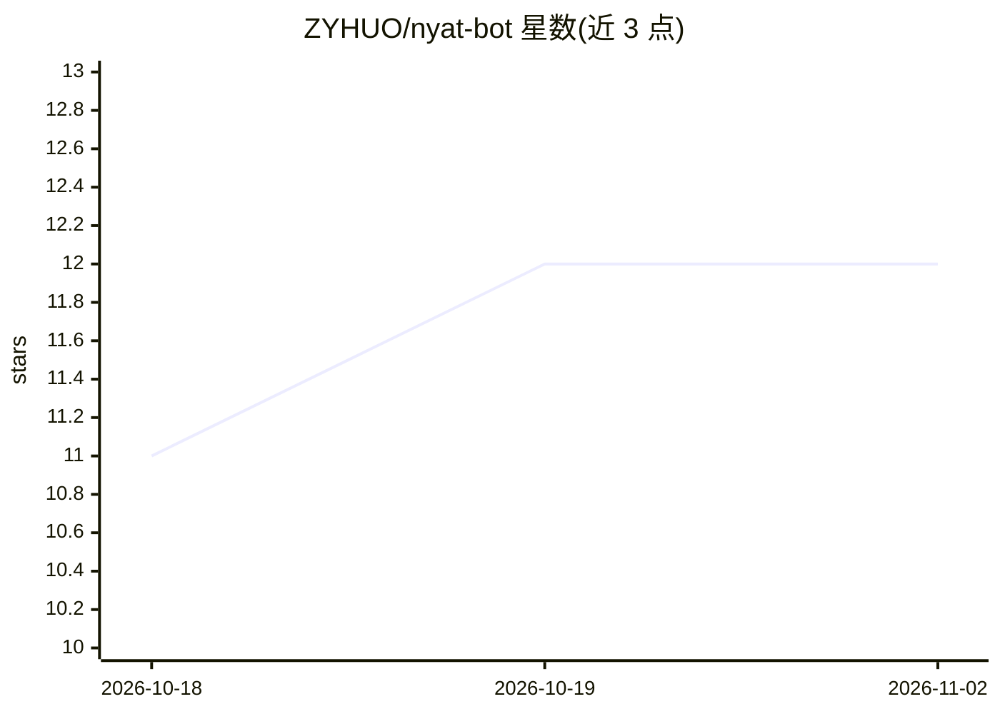

# ZYHUO/nyat-bot

⭐ 12 · TypeScript · MIT · 推送 2026-09-24 · [GitHub](https://github.com/ZYHUO/nyat-bot) · 个人维护 · 中文 README

**Telegram 群聊自主参与型 agent 机器人（TypeScript）**

基于 Node.js/TypeScript/grammy 的 Telegram 群聊 agent：以「参与而非应答」为设计目标，包含心层（决定是否发言）、Turn Actor 回合处理、计时门控、多模型路由与健康池自动分配、上下文引擎、三级判定管线、Nyat Trench 宿主侧身体信号层（发言压力积分器、突发信封、定向回应债务、行为式反广告），以及 Subagent/CodeAct 可选层。面向想在群聊中部署可自主决定发言时机的 agent 的开发者；README 记录了大量审计周期与已知缺陷修复，安装需 npm，实际运行需 bot token 与 AI API。

## 筛选速览

| 维度 | 判定 | 备注 |
|---|---|---|
| AI 角色 | `ai-native` | 本体是模型或模型工具 |
| 许可风险 | `permissive` | MIT |
| 部署形态 | `self-host` | docker 或自建部署 |
| 模型依赖 | — | README 未给出锁定关系 |
| 硬件要求 | — | 无带数字的原话,不猜 |
| 安装摩擦 | `low` | 无编译、无系统依赖或容器化 |
| 成熟度 | — | 结构信号不足 |

## 能力要点

- 心层单一 persona 感知调用决定 reply/wait/pass，沉默为一等决策
- 多模型路由按用途（reply/judge/vision/summarize）建 provider 链，带熔断与延迟池自动分配
- 宿主侧身体信号层：有界发言压力积分器、突发信封、定向回应债务
- 行为式反广告（四类行为信号，无内容关键词），群主显式开启

## 适用场景

- 在 Telegram 群里部署一个观察话题、只在有话说时发言的 agent
- 研究群聊 agent 的发言时机门控与宿主侧约束机制
- 按用途路由多个 LLM provider 并做健康度管理

## 场景标签

`聊天机器人` · 领域:对话与助手

## 证据(README 行号)

> L5: **A Telegram group-chat agent on the path from chatLLM to AGI.**
> L121: - ❤️ **Heart layer** — one persona-aware call replaces three filters: L0 rules miss → a single heart decision (rep
> L127: - 🎯 **Multi-model routing + Smart Group** — per-usage provider chains (reply / judge / vision / summarize / deep_t

## 星数曲线

2026-10-18 11 → 2026-11-02 12（+1）

---
*卡片 v1 · prompt 1.4 · 生成 2026-11-01 · 置信度 high · 依据 README sha `7872de9ae7d1` · [字段定义](../../DATASET.md)*
