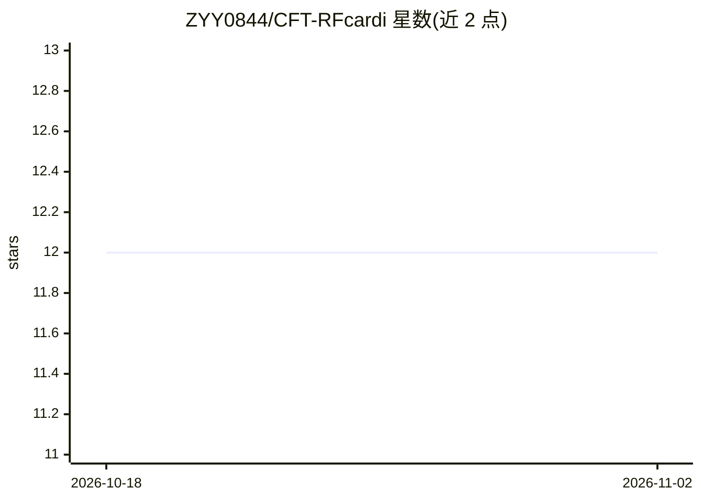

# ZYY0844/CFT-RFcardi

⭐ 12 · Jupyter Notebook · 推送 2026-01-06 · [GitHub](https://github.com/ZYY0844/CFT-RFcardi) · 组织维护 · 中文 README

**雷达信号转 ECG 的迁移学习模型官方实现**

论文 "From High-SNR Radar Signal to ECG" 的官方代码实现：基于心冲击聚焦算法（CFT）与迁移学习方法，从高信噪比雷达信号生成 ECG，面向数据量有限的场景。仓库提供训练/运行入口 main.py 与验证用 visualization.ipynb，数据集（雷达频谱图输入、ECG 真值、稀疏信号锚点，完整版约 50GB 含原始 ADC 与 FMCW 数据）通过百度网盘与 Google Drive 链接下载。

## 筛选速览

| 维度 | 判定 | 备注 |
|---|---|---|
| AI 角色 | `ai-native` | 本体是模型或模型工具 |
| 许可风险 | `none` | — |
| 部署形态 | `None` |  |
| 模型依赖 | — | README 未给出锁定关系 |
| 硬件要求 | — | 无带数字的原话,不猜 |
| 安装摩擦 | `low` | 无编译、无系统依赖或容器化 |
| 成熟度 | — | 结构信号不足 |

## 能力要点

- 雷达信号到 ECG 的迁移学习模型官方实现
- 包含 cardio-focusing（CFT）算法相关数据准备流程
- 提供训练入口脚本与可视化验证 notebook
- 提供可直接运行的训练数据集与示例数据下载链接

## 适用场景

- 复现论文中雷达信号到 ECG 的迁移学习实验
- 在数据有限场景下训练雷达心电估计模型
- 获取雷达心电数据集用于相关研究

## 场景标签

`微调` · 领域:训练与推理

## 证据(README 行号)

> L3: Official implementation of:
> L5: From High-SNR Radar Signal to ECG: A Transfer Learning Model with Cardio-Focusing Algorithm for Scenarios with Limit

## 星数曲线

2026-10-18 12 → 2026-11-02 12（+0）

---
*卡片 v1 · prompt 1.4 · 生成 2026-11-01 · 置信度 high · 依据 README sha `1c32b8db9ed2` · [字段定义](../../DATASET.md)*
