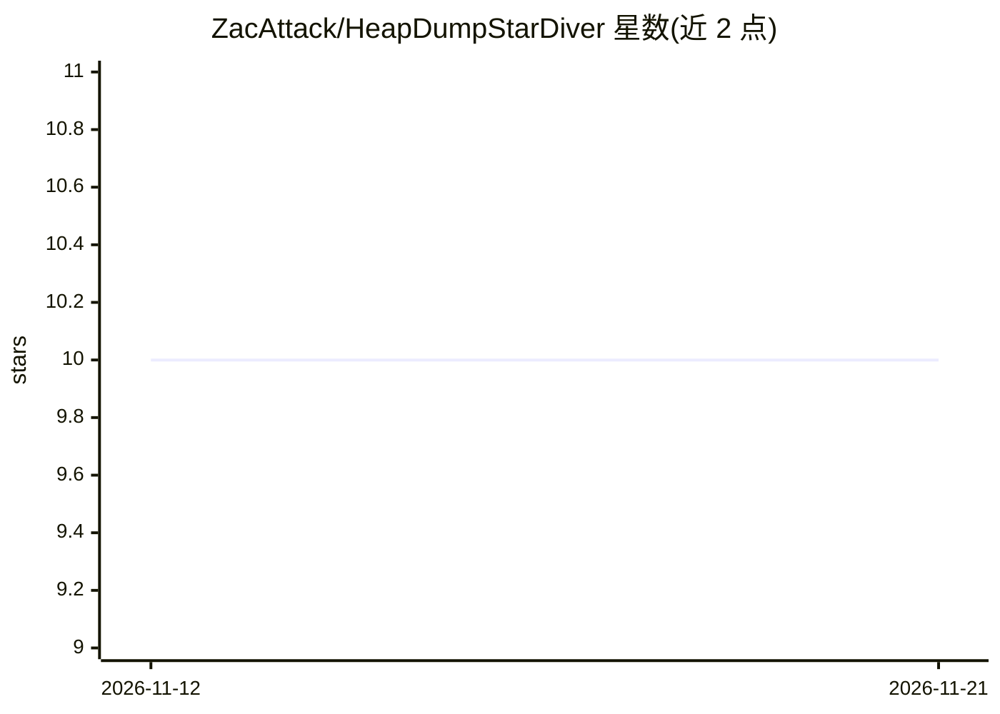

# ZacAttack/HeapDumpStarDiver

⭐ 10 · Java · MIT · 推送 2026-03-26 · [GitHub](https://github.com/ZacAttack/HeapDumpStarDiver) · 个人维护

**JVM 堆转储解析转 Parquet 并支持 AI agent 查询的工具**

用 Rust 编写的 HPROF 堆转储解析工具，将对象实例、类定义、原始数组、对象引用逐条导出为 Parquet 列式文件（每个 Java 类一个文件），支持增量刷盘控制内存占用。提供 stdout 人类可读输出与记录计数命令。内置 MCP 服务器，兼容 Claude Code、Cursor 等 agent 通过 DuckDB SQL 查询与自动 waste 检测。robo-mode 输出牺牲可读性换取更快导出。依赖一个 jvm-hprof crate 的 fork，需在 Cargo.toml 中配置路径。

## 筛选速览

| 维度 | 判定 | 备注 |
|---|---|---|
| AI 角色 | `ai-enhanced` | 去掉 AI 部分产品仍成立 |
| 许可风险 | `permissive` | MIT |
| 部署形态 | `library` | 以包/库形式分发 |
| 模型依赖 | — | README 未给出锁定关系 |
| 硬件要求 | — | 无带数字的原话,不猜 |
| 安装摩擦 | `medium` | 含编译或系统依赖之一 |
| 成熟度 | `idea` | |

## 能力要点

- HPROF 全量解析导出为按类分文件的 Parquet
- robo-mode 面向程序化/LLM 查询的快速导出格式
- 内置 MCP 服务器：会话管理、DuckDB SQL 查询、waste 检测工具
- 增量刷盘（--flush-rows）保持大堆转储下内存有界

## 适用场景

- 把大型 JVM 堆转储导入 DuckDB/PyArrow 做列式分析
- 让 Claude Code 等 agent 自动转换并 SQL 查询堆转储
- 快速查看堆对象概览与 HPROF 记录类型统计

## 场景标签

`文档解析` · 领域:知识与检索

## 证据(README 行号)

> L3: This tool converts JVM heap dumps (HPROF binary format) into Apache Parquet files, enabling columnar analytical proc
> L97: HeapDumpStarDiver includes an MCP (Model Context Protocol) server that lets any compatible AI agent convert heap du

## 星数曲线

2026-11-12 10 → 2026-11-21 10（+0）

---
*卡片 v1 · prompt 1.4 · 生成 2026-11-20 · 置信度 high · 依据 README sha `4d2f1b532f13` · [字段定义](../../DATASET.md)*
