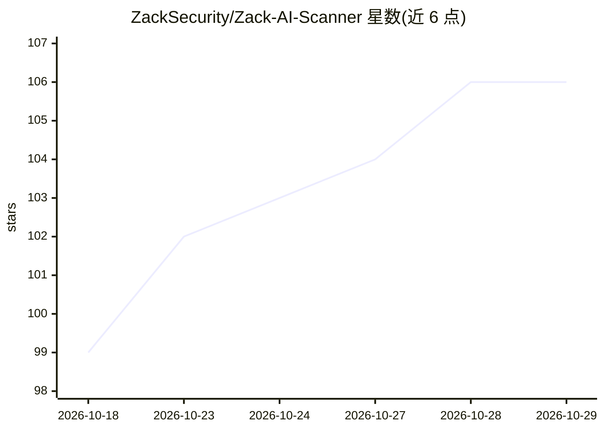

# ZackSecurity/Zack-AI-Scanner

⭐ 106 · Java · GPL-3.0 · 推送 2026-09-27 · [GitHub](https://github.com/ZackSecurity/Zack-AI-Scanner) · 个人维护 · 中文 README

**Burp Suite 的 LLM 驱动漏洞扫描扩展：右键即可对请求做智能测试**

Burp Suite Java 扩展：对已捕获的请求（Proxy/Repeater/Target）按 11 类漏洞或 AI Smart Scan 模式运行分段式 LLM 管线，由模型选择注入点与 payload，真实发包并根据回包证据判定可利用性；每组合发送 9 个 payload（探针+攻击+WAF 绕过），置信度 ≥95 且判定为真才记录发现，OOB 回调由代码直接判定。要求 JDK 17+、Maven 构建，配置 7 家 LLM 提供商或 OpenAI 兼容端点的 API key。非爬虫、非 Burp Scanner 替代品，只处理单个已有请求。

## 筛选速览

| 维度 | 判定 | 备注 |
|---|---|---|
| AI 角色 | `ai-native` | 本体是模型或模型工具 |
| 许可风险 | `viral` | GPL-3.0 |
| 部署形态 | `None` |  |
| 模型依赖 | local-ok | 支持本地模型 |
| 硬件要求 | — | 无带数字的原话,不猜 |
| 安装摩擦 | `medium` | 含编译或系统依赖之一 |
| 成熟度 | — | 结构信号不足 |

## 能力要点

- 11 类专项漏洞扫描 + AI Smart Scan 模式，真实发送 payload 并按证据判定
- 报告门槛：vulnerable==true 且置信度≥95 才记录；OOB 回调（dnslog.org，8-hex 前缀）在代码层判定
- 每个（参数，漏洞类型）组合 9 个 payload：1 探针 + 4 攻击 + 4 WAF 绕过变体
- 支持 7 家预设 LLM 提供商及任意 OpenAI 兼容端点（Ollama/vLLM 经 Custom 接入）

## 适用场景

- 渗透测试中对已有请求做 SQL 注入/XSS/SSRF/反序列化等多类漏洞验证
- 授权测试中利用 OOB 回调确认盲注与 SSRF 出网
- 将扫描结果导出为 HTML/Markdown 报告

## 场景标签

`网络安全` · 领域:学习与行业

## 证据(README 行号)

> L5: > A Burp Suite extension that puts an LLM-driven vulnerability scan behind a right-click — or behind
> L36: Point it at a request (Proxy history, Repeater, Target) and pick either a specific vulnerability type
> L116: |LLM|An API key for OpenAI, Anthropic, Qwen, Zhipu, Kimi, DeepSeek or MiniMax — or any OpenAI-compatible endpoint 

## 星数曲线

2026-10-18 99 → 2026-10-29 106（+7）

---
*卡片 v1 · prompt 1.4 · 生成 2026-10-23 · 置信度 high · 依据 README sha `ed89eeefd9c2` · [字段定义](../../DATASET.md)*
