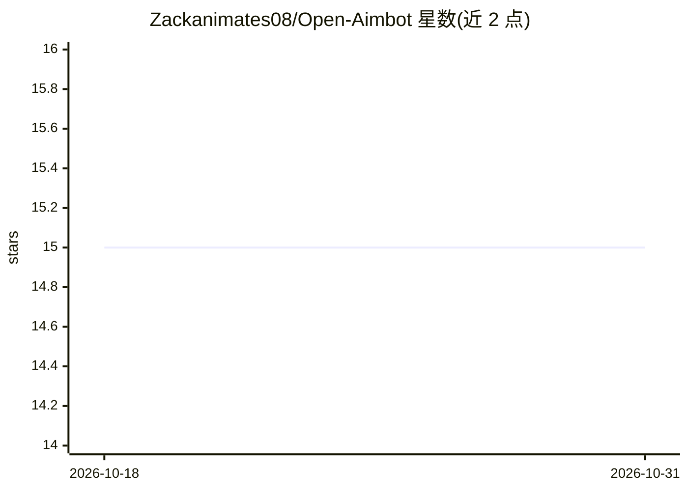

# Zackanimates08/Open-Aimbot

⭐ 15 · MIT · 推送 2026-03-01 · [GitHub](https://github.com/Zackanimates08/Open-Aimbot) · 个人维护

**面向 Roblox 等游戏的通用游戏辅助/脚本工具框架**

Windows 桌面程序，定位为通用开源框架，提供面向 Roblox 的脚本工具、账号防护脚本及多游戏兼容的功能开关（如 aimbot、speed hacks、灵敏度调节）。安装方式为从项目页下载 setup 安装包并运行安装器；要求 Windows 10 及以上、2.0 GHz 处理器、4 GB 内存、100 MB 存储与联网。README 未展示源码内容、构建方式或 AI 技术细节，仓库主题标签含 imitation-learning 与 byfron/hyperion bypass 等反作弊相关词。

## 筛选速览

| 维度 | 判定 | 备注 |
|---|---|---|
| AI 角色 | `ai-enhanced` | 去掉 AI 部分产品仍成立 |
| 许可风险 | `permissive` | MIT |
| 部署形态 | `None` |  |
| 模型依赖 | — | README 未给出锁定关系 |
| 硬件要求 | — | 无带数字的原话,不猜 |
| 安装摩擦 | `low` | 无编译、无系统依赖或容器化 |
| 成熟度 | — | 结构信号不足 |

## 能力要点

- 面向 Roblox 的游戏脚本工具集
- 支持多游戏的功能开关（aimbot、加速等）与参数调节
- Windows 安装包形式分发（setup 安装器）
- 含账号防护/安全脚本类别

## 适用场景

- 在 Roblox 等游戏中启用辅助功能
- 调整 aimbot 灵敏度与速度等参数
- 使用附带的账号防护脚本

## 场景标签

 · 领域:游戏工具/作弊开发

## 证据(README 行号)

> L7: Open Aimbot is a universal open-source framework designed to enhance your gaming experience. With various utilities 
> L53: 2. **Enable Features:** Toggle on the features you wish to use. This can include aimbot, speed hacks, or security s

## 星数曲线

2026-10-18 15 → 2026-10-31 15（+0）

---
*卡片 v1 · prompt 1.4 · 生成 2026-10-31 · 置信度 mid · 依据 README sha `857623c2c6d9` · [字段定义](../../DATASET.md)*
