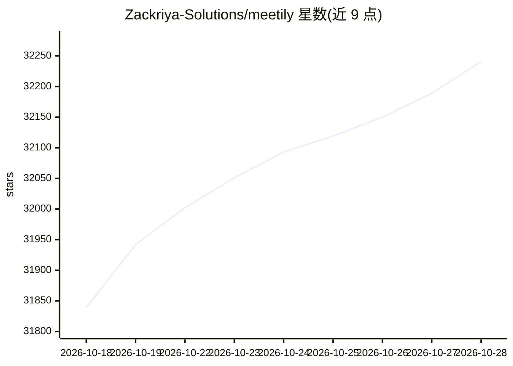

# Zackriya-Solutions/meetily

⭐ 32,241 · Rust · MIT · 推送 2026-10-24 · [GitHub](https://github.com/Zackriya-Solutions/meetily) · [官网](https://meetily.ai) · 组织维护

**本地运行的隐私优先 AI 会议记录与摘要应用**

Meetily 是一款运行在用户本机的会议助手，基于 Tauri（Rust 后端 + Next.js 前端）构建，可捕获麦克风与系统音频、用 Whisper 或 Parakeet 模型实时转录，并生成会议摘要。全部处理与存储在本地完成，不发送数据到云端。摘要支持多种 AI 提供方（推荐本地 Ollama），也可接 Claude、Groq、OpenRouter 或自定义 OpenAI 兼容端点。提供 Windows 安装包、macOS dmg，Linux 需从源码构建；说话人分离在社区版尚未提供（规划于 PRO）。

## 筛选速览

| 维度 | 判定 | 备注 |
|---|---|---|
| AI 角色 | `ai-enhanced` | 去掉 AI 部分产品仍成立 |
| 许可风险 | `permissive` | MIT |
| 部署形态 | `desktop` | 安装包/桌面程序 |
| 模型依赖 | — | README 未给出锁定关系 |
| 硬件要求 | — | 无带数字的原话,不猜 |
| 安装摩擦 | `medium` | 含编译或系统依赖之一 |
| 成熟度 | — | 结构信号不足 |

## 动量与使用信号

- 维护:`active` — 距上次 push 32.6 天,年发版 6,18 位贡献者
- 涨星:近 1 天 **+48**(自 20261016 起算)
- 平台:WINDOWS / MACOS / LINUX · 协议:OPENAI-API / OLLAMA

## 能力要点

- Whisper/Parakeet 模型本地实时转录，无需云端
- 多 AI 提供方摘要：Ollama（本地）、Claude、Groq、OpenRouter、OpenAI 兼容端点
- 麦克风与系统音频同时采集，含 ducking 与削波防护
- GPU 加速：macOS Metal/CoreML 自动启用，Windows 包含 Vulkan 构建

## 适用场景

- 在本地处理会议录音并生成纪要，数据不出设备
- 离线环境下对导入的音频文件生成转录与摘要
- 组织使用自建 OpenAI 兼容端点生成会议摘要

## 场景标签

`语音识别` · 领域:感知与多模态

## 证据(README 行号)

> L23: A privacy-first AI meeting assistant that captures, transcribes, and summarizes meetings entirely on your infrastru
> L37: Meetily is a privacy-first AI meeting assistant that runs entirely on your local machine. It captures your meetings
> L67: - **Flexible AI Provider Support:** Choose from Ollama (local), Claude, Groq, OpenRouter, or use your own OpenAI-co

## 星数曲线

2026-10-18 31,839 → 2026-10-28 32,241（+402）

---
*卡片 v1 · prompt 1.4 · 生成 2026-10-18 · 置信度 mid · 依据 README sha `928aa2d92438` · [字段定义](../../DATASET.md)*
