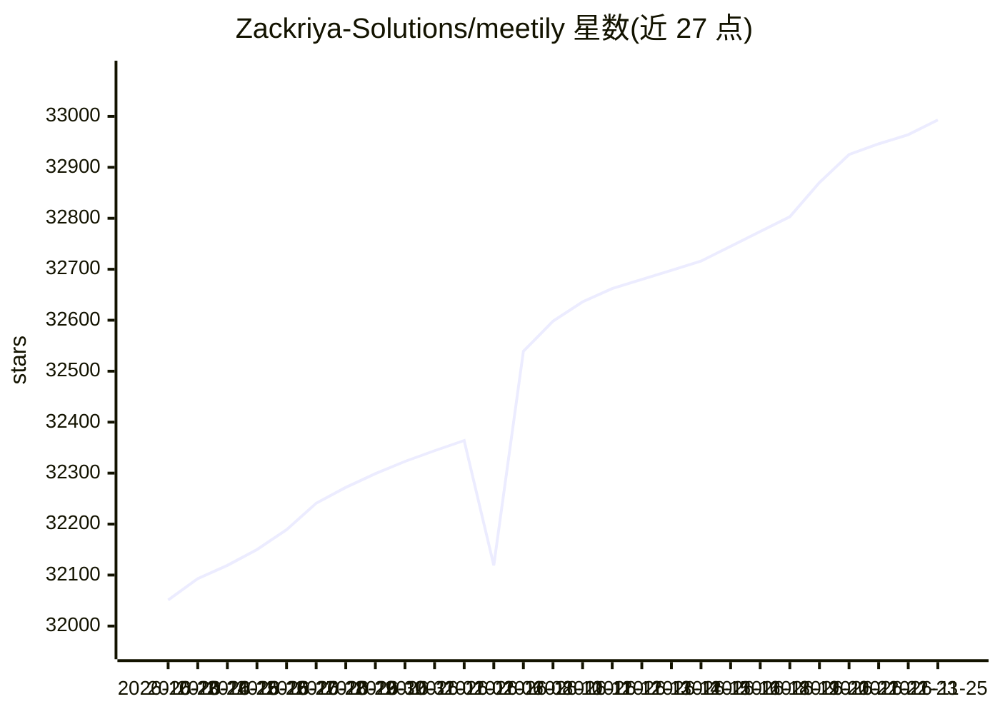

# Zackriya-Solutions/meetily

⭐ 32,993 · Rust · MIT · 推送 2026-11-14 · [GitHub](https://github.com/Zackriya-Solutions/meetily) · [官网](https://meetily.ai) · 组织维护

**本地运行的隐私优先 AI 会议记录助手，转录并生成纪要**

Meetily 是运行在本地机器上的会议助手：捕获会议音频、实时转录（Whisper 或 Parakeet 模型，完全在设备上执行）并默认用本地模型生成摘要，音频与转录数据不离开设备；若选择云厂商做摘要，仅发送转录文本。桌面端基于 Tauri（Rust 后端 + Next.js 前端），提供 Windows/macOS 安装包与 Linux 的 .deb/AppImage/脚本安装，源码构建需 Rust 与 Node.js。社区版 MIT 开源，Pro 付费版提供说话人识别、自定义模板、高级导出等。

## 筛选速览

| 维度 | 判定 | 备注 |
|---|---|---|
| AI 角色 | `ai-native` | 本体是模型或模型工具 |
| 许可风险 | `permissive` | MIT |
| 部署形态 | `desktop` | 安装包/桌面程序 |
| 模型依赖 | local-ok | 支持本地模型 |
| 硬件要求 | — | 无带数字的原话,不猜 |
| 安装摩擦 | `medium` | 含编译或系统依赖之一 |
| 成熟度 | — | 结构信号不足 |

## 动量与使用信号

- 维护:`active` — 距上次 push 32.6 天,年发版 6,18 位贡献者
- 涨星:近 1 天 **+48**(自 20261016 起算)
- 平台:WINDOWS / MACOS / LINUX · 协议:OPENAI-API / OLLAMA

## 能力要点

- 设备端 Whisper/Parakeet 实时转录，无会议机器人加入
- 摘要默认用本地模型，可选 Ollama/Claude/Groq/OpenRouter/自定义 OpenAI 端点
- 同时采集麦克风与系统音频，带 ducking 与削波防护
- GPU 加速：macOS Metal/CoreML、Windows Vulkan，Linux 源码构建配置

## 适用场景

- 在本地记录并总结会议，音频数据不出设备
- 导入已有音频文件生成转录并换模型重转
- 合规要求高的团队自托管会议纪要流程

## 场景标签

`语音识别` `AI 写作` · 领域:内容生成

## 证据(README 行号)

> L37: Meetily is a privacy-first AI meeting assistant that runs entirely on your local machine. It captures your meetings
> L117: Transcribe meetings entirely on your device using **Whisper** or **Parakeet** models. No cloud required.

## 星数曲线

2026-10-23 32,051 → 2026-11-25 32,993（+942）

---
*卡片 v1 · prompt 1.4 · 生成 2026-11-22 · 置信度 high · 依据 README sha `678424c02085` · [字段定义](../../DATASET.md)*
