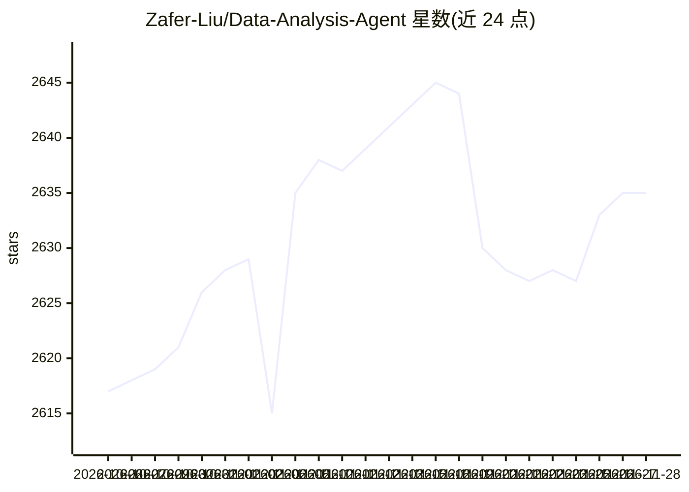

# Zafer-Liu/Data-Analysis-Agent

⭐ 2,635 · JavaScript · NOASSERTION · 推送 2026-11-27 · [GitHub](https://github.com/Zafer-Liu/Data-Analysis-Agent) · [官网](sage-agent.online) · 个人维护 · 中文 README

**对话式数据分析助手：自然语言生成 SQL、图表与报告**

基于 Flask 与 Plotly 的本地 Web 数据分析工作台：用户上传 Excel/CSV 或连接 SQL 数据库后，用自然语言提问，系统自动生成 SQL、执行查询、推荐图表并输出分析结论，过程经 SSE 流式可见。支持 41 种图表类型、导出 Excel/Word/PPT、异常值处理/分箱/K-Means/决策树等分析功能，可扩展 MCP 服务器、业务知识库与飞书多维表格。模型通过 OpenAI 兼容 API 配置，需自备 API Key；提供 Windows 安装包、ZIP、脚本与源码四种安装方式。

## 筛选速览

| 维度 | 判定 | 备注 |
|---|---|---|
| AI 角色 | `ai-native` | 本体是模型或模型工具 |
| 许可风险 | `none` | NOASSERTION |
| 部署形态 | `desktop` | 安装包/桌面程序 |
| 模型依赖 | locked-api |  |
| 硬件要求 | — | 无带数字的原话,不猜 |
| 安装摩擦 | `low` | 无编译、无系统依赖或容器化 |
| 成熟度 | — | 结构信号不足 |

## 能力要点

- 自然语言转 SQL、图表与商业洞察，SSE 流式展示分析过程
- 41 种图表类型自动推荐，支持导出 Excel/Word/PPT
- 数据源支持 Excel/CSV 与 SQLite/MySQL/PostgreSQL/SQL Server
- 可接 MCP 服务器、业务知识库与 A2A 子代理

## 适用场景

- 不写 SQL 直接用中文问数据趋势并出图表
- 把分析结果导出成 Word/PPT 报告给业务方
- 连接 MySQL/PostgreSQL 做区域利润等业务分析
- 上传业务知识让 Agent 更懂自家数据

## 场景标签

`数据分析` · 领域:效率与自动化

## 证据(README 行号)

> L79: |**Ask in plain language**|Turn a business question into SQL, a chart, and an explanation.|
> L140: - Generate SQL
> L187: Supports the following model providers:

## 星数曲线

2026-10-26 2,617 → 2026-11-28 2,635（+18）

---
*卡片 v1 · prompt 1.4 · 生成 2026-11-28 · 置信度 high · 依据 README sha `64be1421e41d` · [字段定义](../../DATASET.md)*
