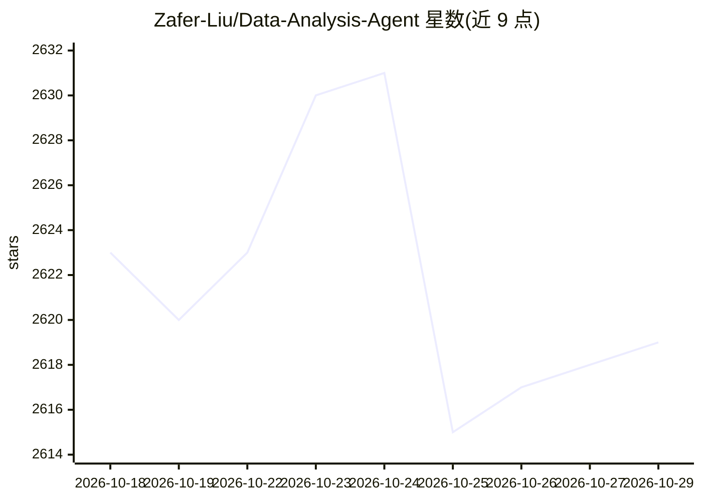

# Zafer-Liu/Data-Analysis-Agent

⭐ 2,619 · JavaScript · NOASSERTION · 推送 2026-10-25 · [GitHub](https://github.com/Zafer-Liu/Data-Analysis-Agent) · [官网](sage-agent.online) · 个人维护 · 中文 README

**对话式商业数据分析 Agent：自然语言生成 SQL、图表与洞察**

基于 Flask + Plotly 的 LLM 数据分析智能体，面向商业分析与非技术用户：上传 Excel/CSV 或连接 SQLite/MySQL/PostgreSQL/SQL Server 后，自然语言提问即可自动识别数据结构、生成并执行 SQL、从 6 大类 43 种图表中推荐可视化并输出业务洞察，过程经 SSE 流式展示。支持 DeepSeek/OpenAI/任意 OpenAI 兼容 API，提供异常值处理、K-Means、决策树等分析与报告/PPT 导出，可接入 MCP 与知识库。采用 CC BY-NC 4.0 授权，禁止未授权商用。

## 筛选速览

| 维度 | 判定 | 备注 |
|---|---|---|
| AI 角色 | `ai-native` | 本体是模型或模型工具 |
| 许可风险 | `none` | NOASSERTION |
| 部署形态 | `desktop` | 安装包/桌面程序 |
| 模型依赖 | locked-api |  |
| 硬件要求 | — | 无带数字的原话,不猜 |
| 安装摩擦 | `low` | 无编译、无系统依赖或容器化 |
| 成熟度 | — | 结构信号不足 |

## 能力要点

- 自然语言→SQL→查询→图表→洞察的自动分析流程，SSE 流式展示
- 支持 Excel/CSV 及 SQLite/MySQL/PostgreSQL/SQL Server 多数据源
- 6 大类 43 种图表自动推荐，导出 Excel/docx/PPT 报告
- 支持 MCP 拓展、知识库输入与飞书机器人多维表格分析

## 适用场景

- 不用写 SQL/公式，直接提问做销售趋势、区域利润等经营分析
- 把业务数据快速变成图表和 Word/PPT 汇报材料
- 在飞书群内 @ 机器人分析多维表格数据

## 场景标签

`数据分析` · 领域:效率与自动化

## 证据(README 行号)

> L16: > 一个面向商业分析场景的 AI Agent。
> L17: > 连接数据源后，用户只需使用自然语言提问，系统即可自动完成：
> L80: 智析Agent是一个对话式商业数据分析智能体，目标是让非技术用户也能像"聊天"一样完成数据分析。
> L92: 1. 理解问题意图

## 星数曲线

2026-10-18 2,623 → 2026-10-29 2,619（-4）

---
*卡片 v1 · prompt 1.4 · 生成 2026-10-21 · 置信度 mid · 依据 README sha `29d93800f157` · [字段定义](../../DATASET.md)*
