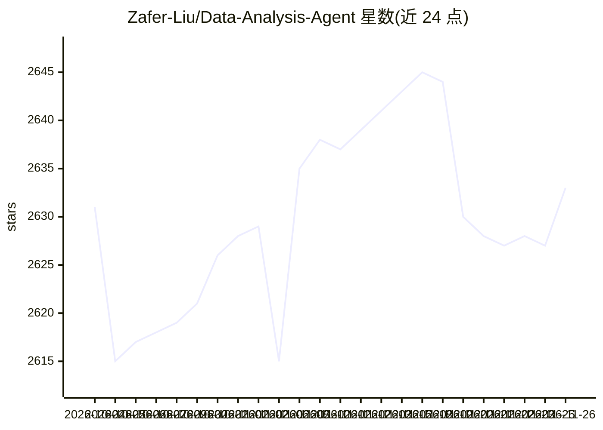

# Zafer-Liu/Data-Analysis-Agent

⭐ 2,633 · JavaScript · NOASSERTION · 推送 2026-11-16 · [GitHub](https://github.com/Zafer-Liu/Data-Analysis-Agent) · [官网](sage-agent.online) · 个人维护 · 中文 README

**面向业务人员的对话式数据分析助手，生成 SQL、图表与报告**

基于 Flask 与 Plotly 的 Web 数据分析工作区：用户用自然语言提问，系统自动生成 SQL、查询数据、推荐图表（41 种类型、6 大类别）并输出分析总结。支持上传 Excel/CSV 或连接 SQLite/MySQL/PostgreSQL/SQL Server，分析过程经 SSE 流式展示；可导出 Excel/Word/PPT 报告，并提供 14 个斜杠命令做图表、聚类、缩尾等分析。安装方式包括 Windows 安装包、ZIP、一键脚本与源码运行，需 Python 3.10+ 并自行配置 OpenAI 兼容 API Key。

## 筛选速览

| 维度 | 判定 | 备注 |
|---|---|---|
| AI 角色 | `ai-native` | 本体是模型或模型工具 |
| 许可风险 | `none` | NOASSERTION |
| 部署形态 | `desktop` | 安装包/桌面程序 |
| 模型依赖 | locked-api |  |
| 硬件要求 | — | 无带数字的原话,不猜 |
| 安装摩擦 | `low` | 无编译、无系统依赖或容器化 |
| 成熟度 | — | 结构信号不足 |

## 能力要点

- 自然语言转 SQL、图表推荐与分析总结，SSE 流式展示四步过程
- 多数据源：Excel/CSV 上传与 SQLite/MySQL/PostgreSQL/SQL Server 连接
- 41 种图表类型与 Excel/Word/PPT 导出
- 支持 MCP 服务器扩展、业务知识库上传与 A2A 子代理调用

## 适用场景

- 上传销售数据，用中文提问获得趋势图表和业务洞察
- 连接公司数据库，免写 SQL 做区域利润排名分析
- 把分析结果一键导出成 Word 报告或 PPT 用于汇报

## 场景标签

`数据分析` · 领域:效率与自动化

## 证据(README 行号)

> L5:  Ask your data. Get SQL, charts, and business insights.
> L132: No SQL required — just type in plain language:
> L152: - **Databases**: SQLite, MySQL, PostgreSQL, SQL Server

## 星数曲线

2026-10-24 2,631 → 2026-11-26 2,633（+2）

---
*卡片 v1 · prompt 1.4 · 生成 2026-11-23 · 置信度 high · 依据 README sha `de0bedaad962` · [字段定义](../../DATASET.md)*
