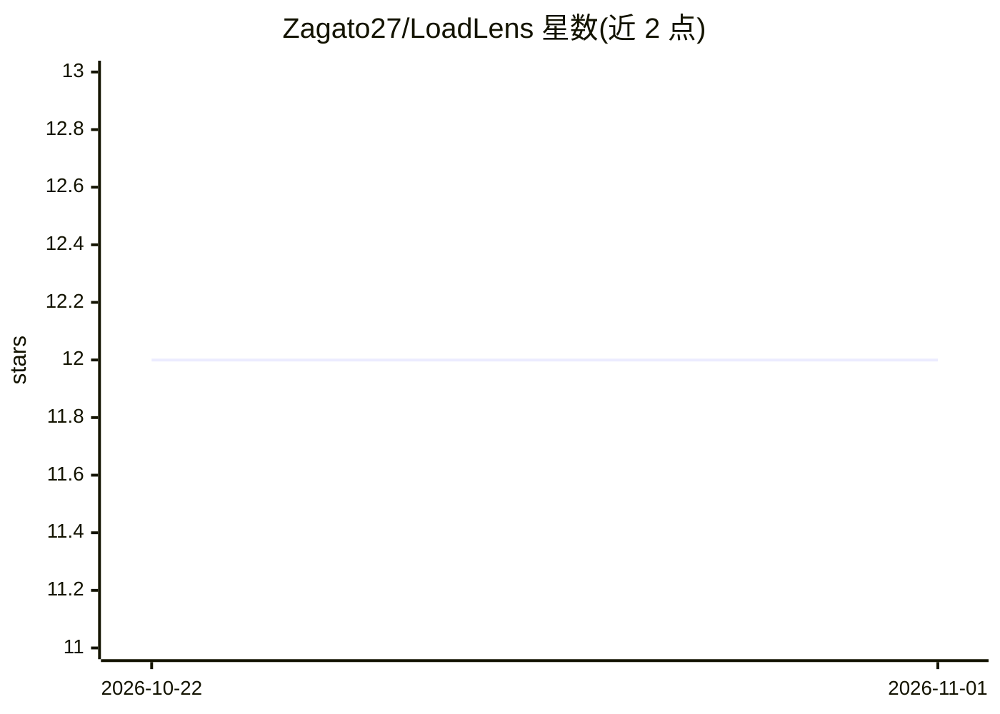

# Zagato27/LoadLens

⭐ 12 · Python · Apache-2.0 · 推送 2026-10-28 · [GitHub](https://github.com/Zagato27/LoadLens) · 个人维护

**从已有监控指标生成功率测试报告与 SLA 判定的 Web 平台**

面向工程团队的负载测试报告平台：读取 Prometheus、VictoriaMetrics 或 InfluxDB（可经 Grafana 代理）中测试窗口的指标，存入 TimescaleDB 后由确定性算法生成负载阶梯、SLA 判定（pass/risk/fail/no_data）、运行对比与 Universal Scalability Law 容量预测；AI 部分按领域做分析，多个候选由 judge 评分，结论中每个数字都与采集数据核验。支持启动 k6/JMeter/Locust/Gatling 测试并发布到 Confluence。以 Docker Compose 部署，需 Python 3.12。

## 筛选速览

| 维度 | 判定 | 备注 |
|---|---|---|
| AI 角色 | `ai-enhanced` | 去掉 AI 部分产品仍成立 |
| 许可风险 | `permissive` | Apache-2.0 |
| 部署形态 | `self-host` | docker 或自建部署 |
| 模型依赖 | — | README 未给出锁定关系 |
| 硬件要求 | — | 无带数字的原话,不猜 |
| 安装摩擦 | `low` | 无编译、无系统依赖或容器化 |
| 成熟度 | — | 结构信号不足 |

## 能力要点

- 从 Prometheus/VictoriaMetrics/InfluxDB（或经 Grafana）读取测试窗口指标并存入 TimescaleDB
- 确定性阶梯检测与 SLA 判定，判定不依赖模型
- AI 分析按领域进行，结论数字逐项与采集数据核验，工程师可覆写判定
- 支持通过 SSH/Docker/Kubernetes/GitLab CI/Jenkins 启动 k6、JMeter、Locust、Gatling 并发布到 Confluence

## 适用场景

- 给 k6/JMeter/Locust/Gatling 测试自动生成带 SLA 判定的报告
- 对比两次压测结果并预测系统容量上限
- 把测试报告与容量预测发布到 Confluence 供团队查阅

## 场景标签

 · 领域:性能测试/可观测性

## 证据(README 行号)

> L5:  Load test reports from the metrics you already collect: load steps, SLA verdicts, AI analysis checked against the d
> L21: - **Deterministic steps and SLA verdicts.** A step detector finds the plateaus, the stable maximum and the moment t
> L72: 4. **AI analysis.** Each domain gets a prompt with its data, the test profile and a structured description of the s

## 星数曲线

2026-10-22 12 → 2026-11-01 12（+0）

---
*卡片 v1 · prompt 1.4 · 生成 2026-11-01 · 置信度 mid · 依据 README sha `e9c60a673d96` · [字段定义](../../DATASET.md)*
