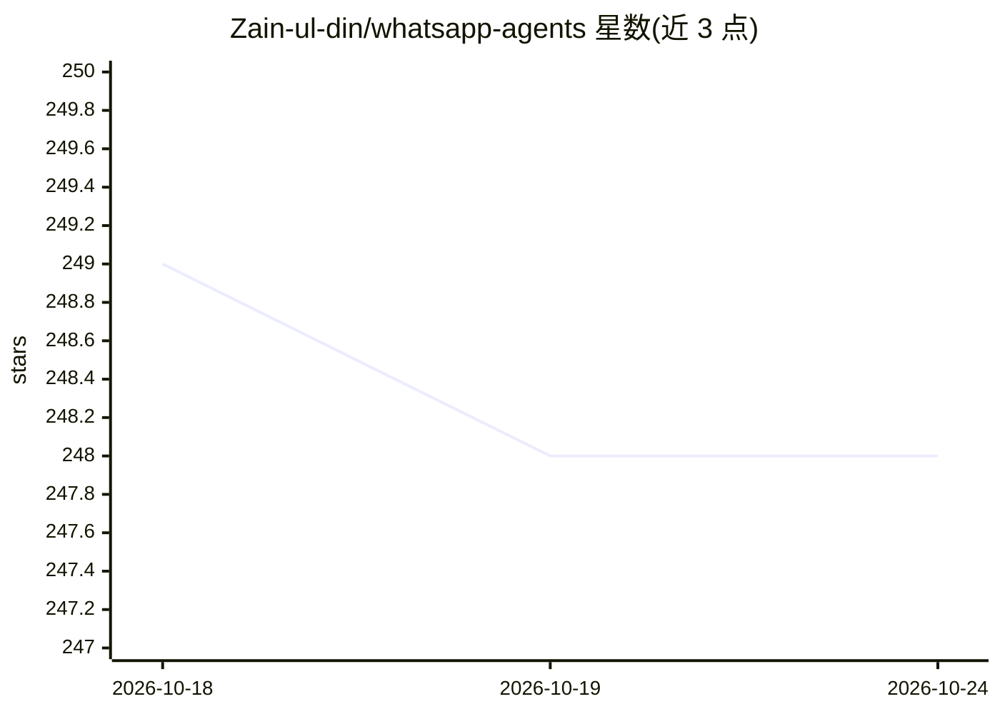

# Zain-ul-din/whatsapp-agents

⭐ 248 · TypeScript · MIT · 推送 2026-10-05 · [GitHub](https://github.com/Zain-ul-din/whatsapp-agents) · [官网](https://wa-ai-seven.vercel.app/) · 个人维护

**接入多家 AI 模型 API 的 WhatsApp 聊天机器人**

基于 baileys 库操作 WhatsApp Web 实例的聊天机器人，通过命令前缀调用多种 AI 模型 API 生成回复：Gemini、ChatGPT、Ollama（文本生成），DALL-E 2/3、Flux、Stability AI（文生图），并支持通过 Base Provider 扩展自定义模型。使用流程为 git clone 源码、在 .env 配置各家 API key、npm run start 后扫码登录。README 声明项目处于活跃开发期，并提示 WhatsApp 官方不支持非官方客户端、有被封风险，OpenAI 与 Stability AI 调用按请求计费。

## 筛选速览

| 维度 | 判定 | 备注 |
|---|---|---|
| AI 角色 | `ai-native` | 本体是模型或模型工具 |
| 许可风险 | `permissive` | MIT |
| 部署形态 | `None` |  |
| 模型依赖 | local-ok | 支持本地模型 |
| 硬件要求 | — | 无带数字的原话,不猜 |
| 安装摩擦 | `low` | 无编译、无系统依赖或容器化 |
| 成熟度 | `idea` | |

## 能力要点

- 支持 Gemini/ChatGPT/Ollama 文本生成与 DALL-E/Flux/Stability AI 文生图
- 通过 !gemini、!dalle 等命令前缀切换模型
- 基于 Base Provider 支持自定义模型扩展
- 通过 baileys 操作 WhatsApp Web 实例并扫码登录

## 适用场景

- 在 WhatsApp 对话中调用多种 AI 模型获取回复或生成图片
- 通过自定义 Provider 接入自己的模型
- 在本地机器或 GitHub Codespaces 上部署私有聊天机器人

## 场景标签

`聊天机器人` `图像生成` · 领域:对话与助手

## 证据(README 行号)

> L7: The WhatsApp AI Agents is a chatbot that uses AI models APIs to generate responses to user input. The bot supports s
> L97: This bot utilizes baileys to operate an actual instance of Whatsapp Web to prevent blocking. However, it is essenti

## 星数曲线

2026-10-18 249 → 2026-10-24 248（-1）

---
*卡片 v1 · prompt 1.4 · 生成 2026-10-22 · 置信度 high · 依据 README sha `f4126dc2efcd` · [字段定义](../../DATASET.md)*
