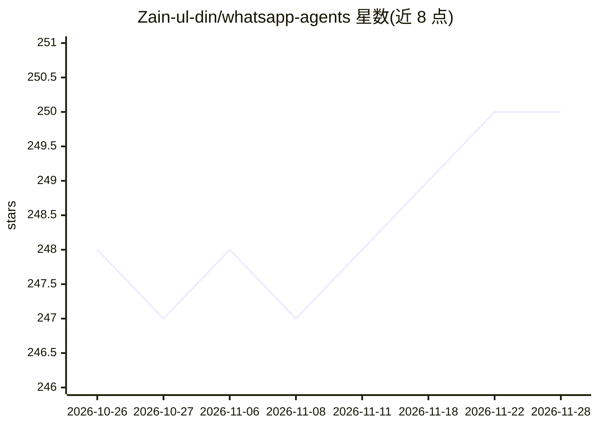

# Zain-ul-din/whatsapp-agents

⭐ 250 · TypeScript · MIT · 推送 2026-11-23 · [GitHub](https://github.com/Zain-ul-din/whatsapp-agents) · [官网](https://wa-ai-seven.vercel.app/) · 个人维护

**把 AI agent 接入 WhatsApp 自动回复消息的机器人**

基于 Baileys 连接 WhatsApp Web 的机器人：按会话排队与批量处理消息，agent 带上下文回答，可调用网页搜索等工具，行为由可编辑的 instructions.md 文件配置而非改代码。内置 PII 防护层：模式匹配加可选 GLiNER 服务把个人信息替换为占位符，每会话独立占位符映射，静态加密（AES-256-GCM），工具调用拒绝含个人数据的查询。Node.js 代码 clone 运行，也可用 docker compose 与检测服务一起启动；README 提示非官方客户端存在封号风险。

## 筛选速览

| 维度 | 判定 | 备注 |
|---|---|---|
| AI 角色 | `ai-native` | 本体是模型或模型工具 |
| 许可风险 | `permissive` | MIT |
| 部署形态 | `self-host` | docker 或自建部署 |
| 模型依赖 | — | README 未给出锁定关系 |
| 硬件要求 | — | 无带数字的原话,不猜 |
| 安装摩擦 | `low` | 无编译、无系统依赖或容器化 |
| 成熟度 | — | 结构信号不足 |

## 能力要点

- 通过 Baileys 连接 WhatsApp，支持二维码登录与持久会话
- PII 防护：个人信息替换为占位符后再送模型，会话级加密映射
- Agent 行为由 agents/instructions.md 配置，无需改代码
- 内置 Exa 驱动的网页搜索工具，拒绝含个人数据的查询

## 适用场景

- 让 AI 自动回复 WhatsApp 上的客户消息
- 希望模型接触不到用户手机号、邮箱等隐私数据
- 为不同场景编写不同 agent 指令文件切换行为

## 场景标签

`聊天机器人` · 领域:对话与助手

## 证据(README 行号)

> L3: WhatsApp Agents connects an AI agent to WhatsApp. Incoming messages are queued per conversation and answered by an a
> L20: - PII guard: personal data is swapped for placeholders before reaching the model (see Privacy)

## 星数曲线

2026-10-26 248 → 2026-11-28 250（+2）

---
*卡片 v1 · prompt 1.4 · 生成 2026-11-25 · 置信度 high · 依据 README sha `f5f6307dd3c0` · [字段定义](../../DATASET.md)*
