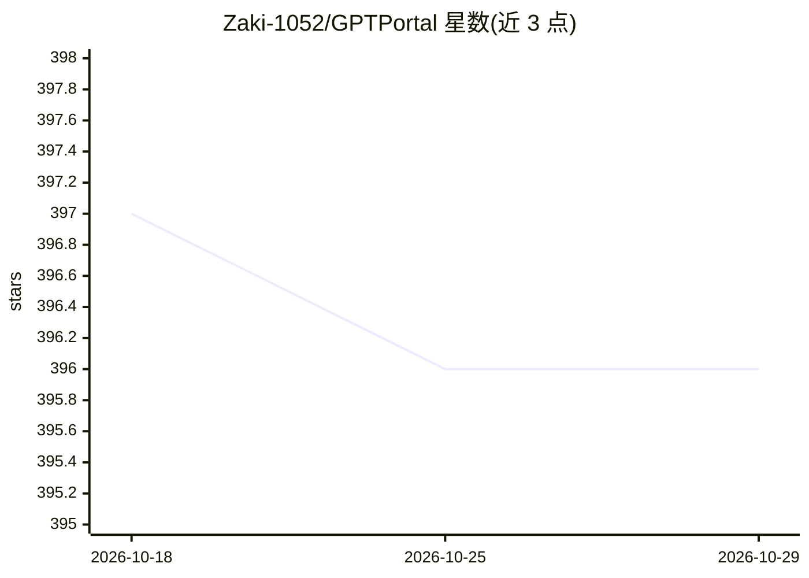

# Zaki-1052/GPTPortal

⭐ 396 · JavaScript · MIT · 推送 2026-07-06 · [GitHub](https://github.com/Zaki-1052/GPTPortal) · [官网](http://localhost:3000/portal) · 个人维护

**自托管的统一 LLM 聊天门户：一个界面接入多家模型 API**

本地优先的 Node/Express Web 应用，无构建步骤、无数据库，前端为手写 HTML/CSS/原生 JS。用户自带 API key，通过单一聊天界面与 OpenAI、Anthropic、Google、xAI、DeepSeek、Groq、Moonshot、Mistral、OpenRouter 全目录及任意 OpenAI 兼容端点（Ollama、LM Studio、vLLM）对话。支持流式输出、视觉、文件上传、语音输入输出、图像生成、多模型对比、成本跟踪与 Basic-Auth 登录门。面向单人或可信家庭本地运行，非多租户 SaaS。

## 筛选速览

| 维度 | 判定 | 备注 |
|---|---|---|
| AI 角色 | `ai-native` | 本体是模型或模型工具 |
| 许可风险 | `permissive` | MIT |
| 部署形态 | `self-host` | docker 或自建部署 |
| 模型依赖 | local-ok | 支持本地模型 |
| 硬件要求 | — | 无带数字的原话,不猜 |
| 安装摩擦 | `low` | 无编译、无系统依赖或容器化 |
| 成熟度 | — | 结构信号不足 |

## 能力要点

- 单一界面接入多家提供商与自建 OpenAI 兼容端点
- 无构建步骤/无框架/无数据库，node server.js 即可运行
- token 流式输出、视觉、语音、文件上传与图像生成等多模态功能
- 多模型对比视图与实时 token/成本跟踪

## 适用场景

- 在一个本地界面里同时使用多家 LLM 提供商的模型
- 把同一条提示发给多个模型对比回答与成本
- 按量付费通过自己的 key 使用各模型，避免多项订阅

## 场景标签

`聊天机器人` `图像生成` · 领域:对话与助手

## 证据(README 行号)

> L3: GPTPortal is a self-hosted, local-first web app that gives you one clean chat interface in front of every major LLM 
> L41: - **Voice**: dictate a message (speech-to-text) and have replies read back to you (text-to-speech).

## 星数曲线

2026-10-18 397 → 2026-10-29 396（-1）

---
*卡片 v1 · prompt 1.4 · 生成 2026-10-21 · 置信度 high · 依据 README sha `7be4d5481a79` · [字段定义](../../DATASET.md)*
