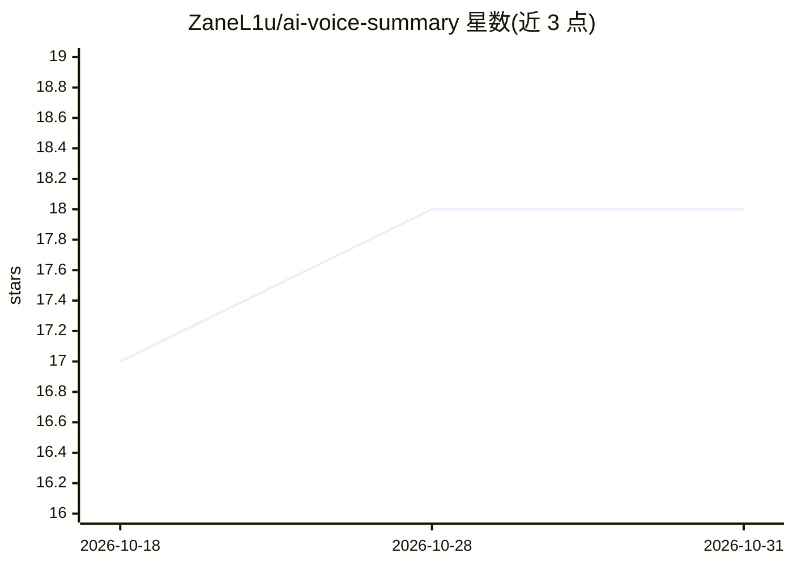

# ZaneL1u/ai-voice-summary

⭐ 18 · Vue · 推送 2026-07-30 · [GitHub](https://github.com/ZaneL1u/ai-voice-summary) · [官网](https://ai-voice-summary-eight.vercel.app) · 个人维护 · 中文 README

**调用火山引擎豆包语音 API 的音频转写与 AI 纪要 Web 应用**

基于 Nuxt 4 构建的音频转写工具：用户上传音频后经服务端代理提交到火山引擎豆包语音妙记 API，获得带说话人分离的转写文本、AI 自动总结，并支持歌词式同步播放高亮、说话人重命名、音频下载与裁剪。Token 存于浏览器 localStorage，任务记录与音频存于 IndexedDB，服务端不保存用户数据，可选配置 S3 兼容存储（R2/MinIO）。提供 Docker、Vercel/Netlify/Cloudflare 及本地 pnpm 多种部署方式。

## 筛选速览

| 维度 | 判定 | 备注 |
|---|---|---|
| AI 角色 | `ai-native` | 本体是模型或模型工具 |
| 许可风险 | `none` | — |
| 部署形态 | `self-host` | docker 或自建部署 |
| 模型依赖 | — | README 未给出锁定关系 |
| 硬件要求 | — | 无带数字的原话,不猜 |
| 安装摩擦 | `low` | 无编译、无系统依赖或容器化 |
| 成熟度 | — | 结构信号不足 |

## 能力要点

- 接入火山引擎豆包语音妙记 API，支持说话人分离与重命名
- AI 自动生成音频内容摘要
- 歌词式同步播放高亮当前句子
- Token 与任务数据存储在浏览器本地，服务端不保存用户数据

## 适用场景

- 把会议或访谈录音转成可读文本并生成摘要
- 多人对话场景区分说话人并回放核对
- 自部署一个无需服务端保存数据的转写工具

## 场景标签

`语音识别` · 领域:感知与多模态

## 证据(README 行号)

> L3: 基于火山引擎豆包语音妙记 API 的音频转写工具，支持说话人分离、AI 总结、同步播放。基于 Nuxt 4 构建，完全隐私安全，零配置开箱即用，Serverless 友好~
> L15: - 🤖 **AI 总结** - 自动生成会议/音频内容摘要
> L45: docker run -d -p 3000:3000 ghcr.io/ZaneL1u/ai-voice-summary:latest

## 星数曲线

2026-10-18 17 → 2026-10-31 18（+1）

---
*卡片 v1 · prompt 1.4 · 生成 2026-10-29 · 置信度 mid · 依据 README sha `820175e8eb84` · [字段定义](../../DATASET.md)*
