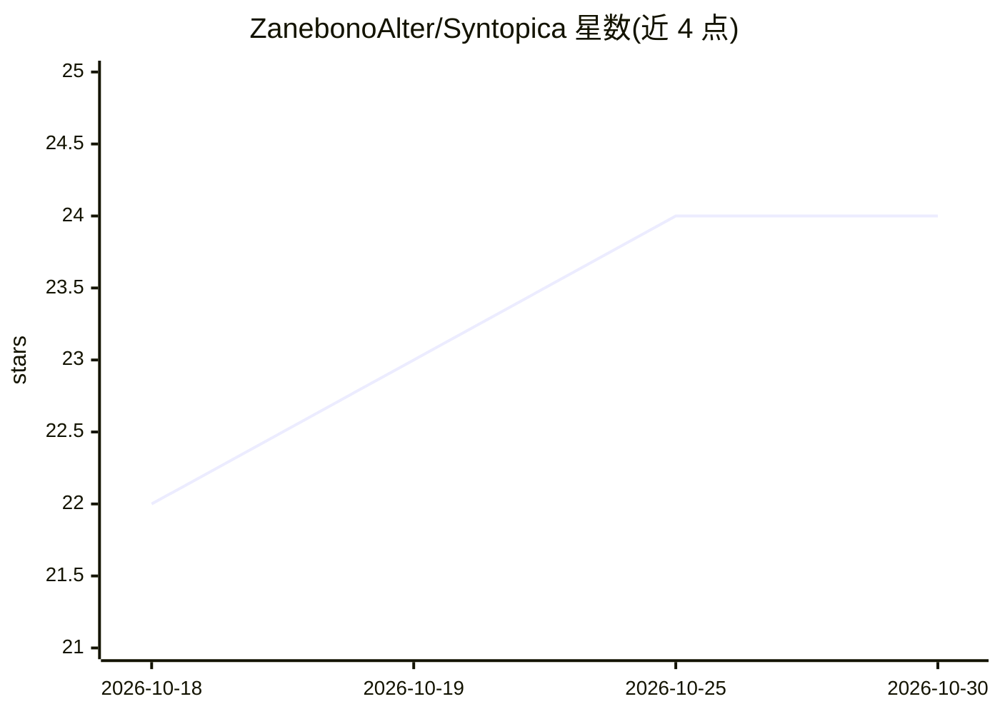

# ZanebonoAlter/Syntopica

⭐ 24 · Go · GPL-3.0 · 推送 2026-10-11 · [GitHub](https://github.com/ZanebonoAlter/Syntopica) · 个人维护 · 中文 README

**面向个人研究的语义化 RSS 信息工作台：把订阅整理成主题脉络**

从 RSS、RSSHub 和网页等自选信息源采集内容，补全正文、生成摘要与语义标签，将文章归入用户维护的语义板块，产出板块日报、叙事线索、跨日话题演进与主题图谱；板块匹配用标签命中与向量相似度在本地计算，不调用 LLM。LLM 触点收敛于单篇整理、板块日报叙事和手动触发的信号研究三处。支持多 AI Provider 按能力路由，部署依赖 Docker 与 PostgreSQL+pgvector，单用户无认证，研究数据源接入处于 alpha 阶段。

## 筛选速览

| 维度 | 判定 | 备注 |
|---|---|---|
| AI 角色 | `ai-native` | 本体是模型或模型工具 |
| 许可风险 | `viral` | GPL-3.0 |
| 部署形态 | `self-host` | docker 或自建部署 |
| 模型依赖 | local-ok | 支持本地模型 |
| 硬件要求 | — | 无带数字的原话,不猜 |
| 安装摩擦 | `low` | 无编译、无系统依赖或容器化 |
| 成熟度 | `idea` | |

## 能力要点

- 语义板块归类：标签命中+向量相似度+加权规则，本地计算且带逐条解释
- 板块日报、泳道动态与跨日话题演进（新兴/持续/分化/合并/结束状态）
- 兴趣画像驱动 RSSHub 订阅源发现：向量粗筛+LLM 精排推荐
- 多 AI Provider 管理：按能力路由、主备降级，支持 OpenAI 兼容/Ollama/llama.cpp

## 适用场景

- 长期跟踪技术、行业或学术动态，把多来源报道整理为事件线索
- 已有大量 RSS 订阅，希望按主题而非未读列表组织阅读
- 对板块内容做带预算控制的信号深入分析与报告追问

## 场景标签

`语义搜索` · 领域:知识与检索

## 证据(README 行号)

> L13: 它从 RSS、RSSHub 和网页等自选信息源持续采集内容，补全正文，生成摘要与语义标签；再把分散的文章归入用户维护的语义板块，形成板块日报、叙事线索、跨日话题演进和主题图谱。
> L85: Syntopica 同样需要 LLM 来理解文章——摘要、语义标签、Embedding 都是每篇文章进入时做一次的加工，没有绕开这一步。多出来的这层结构不是目的，而是让后续的组织可以复用：创建或调整板块时，用已有标签和语义匹配把历

## 星数曲线

2026-10-18 22 → 2026-10-30 24（+2）

---
*卡片 v1 · prompt 1.4 · 生成 2026-10-27 · 置信度 high · 依据 README sha `e8798cae515b` · [字段定义](../../DATASET.md)*
