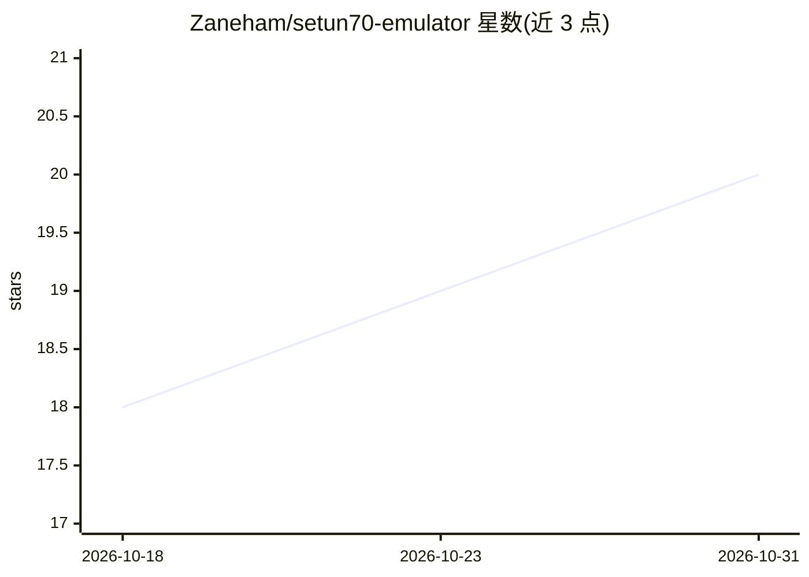

# Zaneham/setun70-emulator

⭐ 20 · HTML · MIT · 推送 2026-08-24 · [GitHub](https://github.com/Zaneham/setun70-emulator) · 个人维护

**苏联 Setun 70 三进制计算机（1970）的 Python 模拟器**

用 Python 3.10+ 实现的莫斯科大学 1970 年平衡三进制计算机 Setun 70 的模拟器，依据 Brusentsov 等人 1970 年原始论文从档案资料重建架构。支持平衡三进制数（-1/0/+1）、POLIZ（逆波兰式）双栈执行、6-trit 音节式程序、27 页×81 音节内存模型，提供汇编器与指令集（LIT/ADD/DIV 等）。可通过 PyPI 或源码安装，作为库调用，或运行示例程序，另有免安装的网页版模拟器可自行部署到 GitHub Pages。

## 筛选速览

| 维度 | 判定 | 备注 |
|---|---|---|
| AI 角色 | `ai-knowledge` | 知识聚合/清单类 |
| 许可风险 | `permissive` | MIT |
| 部署形态 | `library` | 以包/库形式分发 |
| 模型依赖 | — | README 未给出锁定关系 |
| 硬件要求 | — | 无带数字的原话,不猜 |
| 安装摩擦 | `low` | 无编译、无系统依赖或容器化 |
| 成熟度 | — | 结构信号不足 |

## 能力要点

- 依据 1970 年原始论文重建的三进制栈式机器架构
- 提供汇编器与 POLIZ 汇编指令集，可作为 Python 库使用
- 网页版模拟器可免安装在线运行或部署到 GitHub Pages
- 含 hello、factorial、quadratic 等示例程序与 --debug 调试

## 适用场景

- 学习平衡三进制与栈式计算机体系结构
- 编写并执行 POLIZ 汇编程序观察三进制机器运行
- 作为库集成到教学或历史计算研究项目

## 场景标签

 · 领域:计算史/模拟器

## 证据(README 行号)

> L6: **A working emulator of the Soviet Setun 70 ternary computer (1970), reconstructed from archival documentation.**
> L13: The Setun 70 was a **balanced ternary computer** developed at Moscow State University in 1970. It used:
> L19: This emulator reconstructs the architecture from the original 1970 paper by Brusentsov, Zhogolev, and Maslov, recov

## 星数曲线

2026-10-18 18 → 2026-10-31 20（+2）

---
*卡片 v1 · prompt 1.4 · 生成 2026-10-28 · 置信度 mid · 依据 README sha `81501ee2cdad` · [字段定义](../../DATASET.md)*
