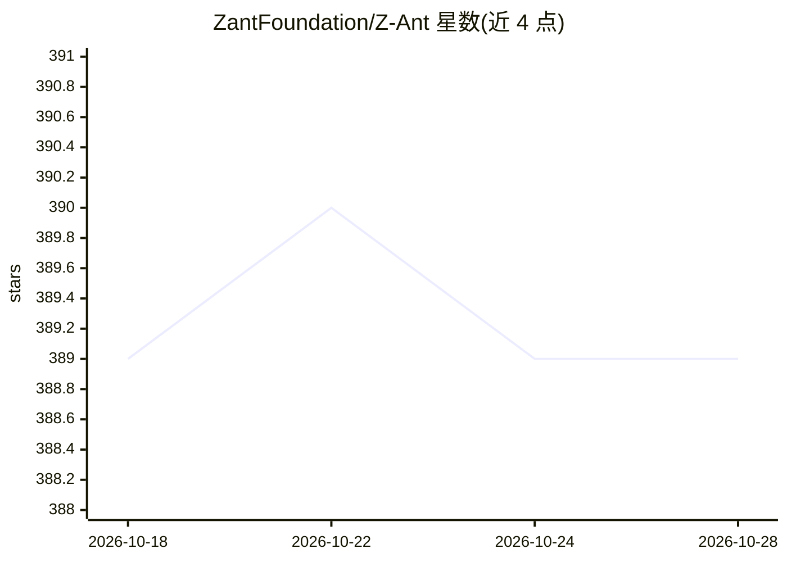

# ZantFoundation/Z-Ant

⭐ 389 · Zig · Apache-2.0 · 推送 2026-07-18 · [GitHub](https://github.com/ZantFoundation/Z-Ant) · [官网](https://zantfoundation.github.io/Website/) · 组织维护

**面向 MCU 的神经网络编译与推理框架，ONNX 转静态库**

开源推理引擎与编译框架，面向资源受限微控制器（ARM Cortex-M、RISC-V 等）部署深度神经网络。以标准 ONNX 模型为输入，在编译期完成图调度、内存规划与优化决策，输出确定性的 Zig/C 静态库，可直接集成到裸机固件。支持 30+ 算子、量化/剪枝/内存优化、内置 JPEG 解码与图像预处理，并提供 GAF/MTF 时序编码用于 CNN 时序分类。构建依赖 Zig 0.15.x，可选 QEMU、CMSIS-NN 等，通过 CMake 或 Arduino/嵌入式 C 集成。

## 筛选速览

| 维度 | 判定 | 备注 |
|---|---|---|
| AI 角色 | `ai-ecosystem` | LLM/agent 周边工具 |
| 许可风险 | `permissive` | Apache-2.0 |
| 部署形态 | `None` |  |
| 模型依赖 | — | README 未给出锁定关系 |
| 硬件要求 | — | 无带数字的原话,不猜 |
| 安装摩擦 | `medium` | 含编译或系统依赖之一 |
| 成熟度 | — | 结构信号不足 |

## 能力要点

- ONNX 模型编译为确定性 Zig/C 静态库，编译期完成调度与内存规划
- 支持 30+ 算子及量化、剪枝、内存优化
- 微秒级推理，覆盖 ARM Cortex-M、RISC-V、x86
- 内置 JPEG 解码预处理与 GAF/MTF 时序编码模块

## 适用场景

- 把 ONNX 分类模型部署到 Cortex-M 裸机固件
- 无 MMU、小 SRAM 的 MCU 上做确定性神经网络推理
- ECG 等时序信号用 GAF/MTF 编码后经 CNN 分类

## 场景标签

`推理引擎` `模型量化` · 领域:训练与推理

## 证据(README 行号)

> L15: **Zant** presents an open-source inference engine and compiler framework designed specifically to bridge this gap. 
> L11: The deployment of deep neural networks on resource-constrained microcontrollers (MCUs) presents a fundamental engin

## 星数曲线

2026-10-18 389 → 2026-10-28 389（+0）

---
*卡片 v1 · prompt 1.4 · 生成 2026-10-21 · 置信度 high · 依据 README sha `73f0d2f2027c` · [字段定义](../../DATASET.md)*
