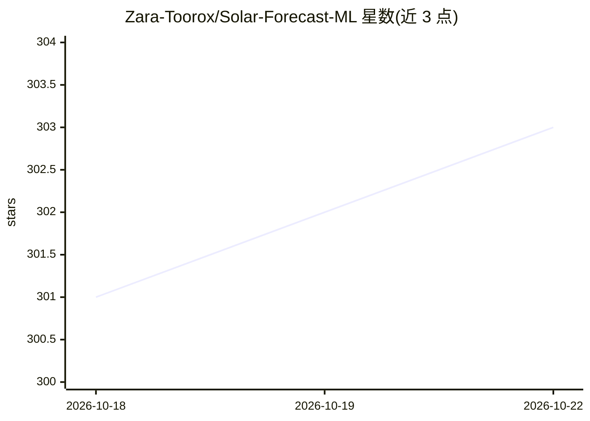

# Zara-Toorox/Solar-Forecast-ML

⭐ 303 · Python · NOASSERTION · 推送 2026-10-16 · [GitHub](https://github.com/Zara-Toorox/Solar-Forecast-ML) · [官网](https://solarforecastml.com/en/) · 个人维护

**Home Assistant 本地 AI 太阳能发电预测集成**

面向家庭光伏用户的 Home Assistant 集成：在用户自己的硬件上运行带注意力机制的 Transformer（预训练于多年天气气候数据），基于用户自有测量数据训练，输出未来 72 小时的逐时发电预测，并测量和展示预测质量。数据全部留在本地，无云端服务、无语言模型参与、无遥测。需 DC 功率传感器与系统参数；不适用于无 DC 读数或交耦合储能系统。核心预测为 SFML 本体，另有通过 install_extras 安装的可选伴随模块（STATS、Energy AI、Grid Price Monitor）。部分代码经 PyArmor 保护，许可为专有非商业（个人与教育免费）。

## 筛选速览

| 维度 | 判定 | 备注 |
|---|---|---|
| AI 角色 | `ai-native` | 本体是模型或模型工具 |
| 许可风险 | `none` | NOASSERTION |
| 部署形态 | `None` |  |
| 模型依赖 | — | README 未给出锁定关系 |
| 硬件要求 | — | 无带数字的原话,不猜 |
| 安装摩擦 | `low` | 无编译、无系统依赖或容器化 |
| 成熟度 | — | 结构信号不足 |

## 能力要点

- 本地运行带注意力的 Transformer，逐时预测未来 72 小时光伏发电
- 预训练于多年天气气候数据，再用用户自有测量继续学习
- 测量并展示预测质量（准确率、偏差、可用数据天数）
- 数据完全留在本地，无遥测、无云端训练

## 适用场景

- 家庭光伏发电量逐时预测，考虑自家阴影与朝向
- 配合电池做基于电价与预测的智能充电
- 审计自家光伏系统的实际发电表现与预测质量

## 场景标签

 · 领域:能源管理/家庭自动化

## 证据(README 行号)

> L5:  The first and only Home Assistant integration that forecasts solar production with a local AI — a transformer with 
> L38: - **A local AI that forecasts solar production.** Every other solar integration either queries a cloud service or a
> L40: - **A model pre-trained on multi-year weather and climate data.** It does not start from zero on your roof. It star

## 星数曲线

2026-10-18 301 → 2026-10-22 303（+2）

---
*卡片 v1 · prompt 1.4 · 生成 2026-10-21 · 置信度 high · 依据 README sha `ec62fc046953` · [字段定义](../../DATASET.md)*
