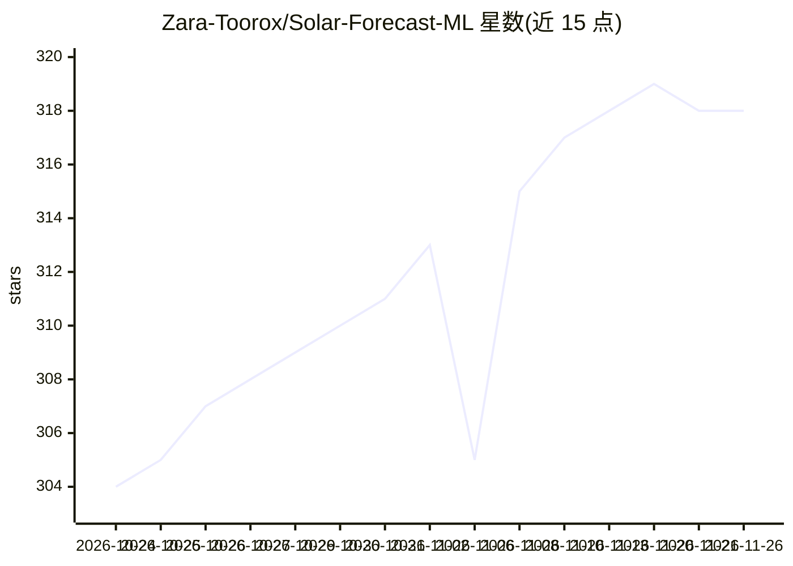

# Zara-Toorox/Solar-Forecast-ML

⭐ 318 · Python · NOASSERTION · 推送 2026-11-23 · [GitHub](https://github.com/Zara-Toorox/Solar-Forecast-ML) · [官网](https://solarforecastml.com/en/) · 个人维护

**Home Assistant 本地 AI 光伏发电预测集成，数据不出户**

运行在 Home Assistant 内的太阳能发电预测集成，用本地注意力 Transformer 在用户自家硬件上训练并每日重算，输出 72 小时逐小时预测、准确率与偏差等质量指标，结果发布为 HA 传感器。以多年气象气候数据预训练的模型为基础，再学习用户屋面（遮挡、逆电器限制、面板分组）。要求 DC 功率传感器与系统参数，不支持无 DC 读数或交流耦合电池系统。核心代码经 PyArmor 保护，专有非商业许可。

## 筛选速览

| 维度 | 判定 | 备注 |
|---|---|---|
| AI 角色 | `ai-native` | 本体是模型或模型工具 |
| 许可风险 | `none` | NOASSERTION |
| 部署形态 | `None` |  |
| 模型依赖 | — | README 未给出锁定关系 |
| 硬件要求 | — | 无带数字的原话,不猜 |
| 安装摩擦 | `low` | 无编译、无系统依赖或容器化 |
| 成熟度 | `idea` | |

## 能力要点

- 本地注意力 Transformer，在 Home Assistant 硬件上训练与推理，无需 TensorFlow/PyTorch
- 多年气象气候数据预训练模型，再学习用户自身安装条件
- 72 小时逐小时预测并量化展示准确率、偏差与可用数据天数
- 无遥测、无云训练，模型权重本地加密存储

## 适用场景

- 不依赖云服务预测自家光伏每日发电量
- 结合动态电价做电池智能充电排程
- 在 Home Assistant 仪表盘展示发电预测与实时能量流

## 场景标签

 · 领域:智能家居/能源管理

## 证据(README 行号)

> L5:  The first and only Home Assistant integration that forecasts solar production with a local AI — a transformer with 
> L35: Solar Forecast ML runs a complete local AI stack inside Home Assistant. It trains on your measurements, corrects it

## 星数曲线

2026-10-24 304 → 2026-11-26 318（+14）

---
*卡片 v1 · prompt 1.4 · 生成 2026-11-25 · 置信度 high · 依据 README sha `9d88c78d78a6` · [字段定义](../../DATASET.md)*
